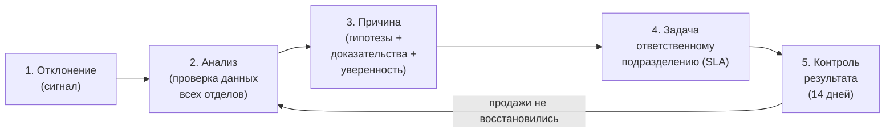

# 01. Концепция DairyHub

| Атрибут | Значение |
|---|---|
| Продукт | DairyHub — цифровая платформа управления торговой командой молочной компании |
| Рынок | Республика Казахстан, валюта — тенге (₸) |
| Версия документа | 1.0 |
| Статус | Черновик для согласования с заказчиком |
| Связанные документы | [02 — Бизнес-требования](02-business-requirements.md), [03 — Системный анализ](03-system-analysis.md), [05 — План проекта](05-project-plan.md) |

---

## 1. Идея

Молочная компания продаёт продукцию через сеть торговых точек (магазины, минимаркеты, киоски), которые обслуживают торговые представители. Каждый день в компании возникают отклонения — пропущенный визит, падение продаж в точке, морозильник без продаж, задержка отгрузки, заблокированная из-за дебиторки поставка. Каждое такое отклонение видно только части компании: представитель знает, что на полке пусто; склад знает, что машина ушла с недогрузом; бухгалтерия знает, что точка на стоп-листе; руководитель видит только итоговую цифру продаж в конце месяца.

**DairyHub объединяет эти разрозненные сигналы в одну картину и превращает каждое отклонение в конкретную задачу для того подразделения, которое реально может его устранить.**

Платформа состоит из:

- **мобильного веб-приложения (PWA)** для торгового представителя — маршрут дня, GPS-отметка визита, фотоотчёт, проверка морозильника, задачи;
- **веб-панели** для руководителя, склада, бухгалтерии и администратора — сигналы, причины, задачи, планы, оборудование, аналитика;
- **движка правил**, который обнаруживает отклонения, проверяет возможные причины по данным всех подразделений и маршрутизирует задачи.

## 2. Цель

Сократить время между возникновением отклонения в продажах и его устранением за счёт того, что:

1. отклонение обнаруживается автоматически, а не в конце месяца;
2. причина устанавливается по данным, а не по мнению;
3. задача сразу попадает к ответственному подразделению с понятным сроком (SLA);
4. результат устранения контролируется, а не предполагается.

## 3. Ценность для каждой роли

| Роль | Что получает | Чем меньше занимается |
|---|---|---|
| **Торговый представитель** | Маршрут дня в одном экране; подтверждение визита одним действием; понятный список задач по каждой точке; справедливая оценка выполнения плана (потери из-за склада и дебиторки не засчитываются ему в минус); подсказки по выкладке и морозильнику | Бумажными отчётами, звонками «почему нет отгрузки», объяснениями за чужие ошибки |
| **Руководитель / супервайзер** | Сигналы об отклонениях в день их появления; гипотезы о причинах с доказательствами и уровнем уверенности; контроль исполнения задач всеми отделами; объективные данные о визитах | Ручным сведением таблиц, выяснением «кто виноват», контролем по телефону |
| **Склад** | Задачи, связанные с конкретными точками и падением продаж, с SLA 24 ч; видимость, к чему приводят задержки и недогрузы | Разрозненными жалобами от представителей в мессенджерах |
| **Бухгалтерия** | Задачи по дебиторке, блокирующей отгрузку в точку с активными продажами, с SLA 48 ч; данные о последствиях блокировок | Неструктурированными просьбами «разблокировать точку» |
| **Администратор** | Управление пользователями, ролями, приглашениями, справочниками; журнал аудита | Ручной выдачей доступов и сбросом паролей вне системы |
| **Руководство компании** | Прозрачная картина: где теряются продажи и какой отдел может это исправить; основание для решений по оборудованию и ценам | Решениями «вслепую» |

## 4. Пять проблем → пять решений

| № | Проблема (AS-IS) | Решение в DairyHub (TO-BE) | Ключевые правила |
|---|---|---|---|
| П1 | **Визиты не контролируются.** Нет достоверных данных, был ли представитель в точке и сколько времени провёл. Отчёты заполняются задним числом. | GPS-отметка визита (check-in / check-out) с геозоной; фотоотчёт; автоматическое выявление пропущенных и коротких визитов; напоминания об отчётах. | Геозона 150 м; точность GPS хуже 100 м — предупреждение; визит < 5 мин — «короткий визит»; нет check-in до 19:00 — «пропущенный визит» (≥ 3 пропусков у представителя за 7 дней — сигнал и задача руководителю); отчёт не заполнен через 30 мин после check-out — напоминание; итоговое напоминание в 18:00. |
| П2 | **Падение продаж замечают поздно**, а причину ищут в ручном режиме, часто обвиняя представителя. | Автоматическое обнаружение падения и межотдельная проверка причин с гипотезами, доказательствами и задачей ответственному подразделению. | Последние 7 дней vs среднее за предыдущие 4 недели; падение ≥ 30% → сигнал; 7 групп причин; контроль результата 14 дней. |
| П3 | **План продаж несправедлив.** Планы «спускаются сверху», а представитель отвечает и за потери, вызванные складом или дебиторкой. | Расчётный план по точке и «скорректированное выполнение», исключающее потери не по вине представителя; прозрачная шкала премирования. | План = среднее за 3 мес × сезонность × потенциал (A 1,10 / B 1,00 / C 0,95); скорректированное выполнение исключает «извинительные» потери после проблемных поставок; пороги 80% / 100% / 120%; суммы премий задаёт компания. |
| П4 | **Морозильное оборудование не учитывается.** Неизвестно, где стоит морозильник, работает ли он, держит ли температуру. | Единый реестр морозильников с привязкой к точке, серийным номером, фотоверификацией на каждом визите; процесс ремонта/замены; датчики температуры на выбранных морозильниках. | «Оборудование отсутствует» → сигнал руководителю + задача; норма ≤ −18 °C; > −15 °C дольше 2 ч → задача руководителю (вызывает сервисную организацию) и параллельная задача представителю проверить крышку и питание; статусы В работе → Ремонт → Замена → Списание. |
| П5 | **Морозильники стоят без продаж.** Оборудование занимает место, расходует ресурс, но не приносит выручку; решения о перемещении принимаются интуитивно. | Программа «Морозильник без продаж» из 4 этапов с диагностикой 6 причин и, при необходимости, расчётной оценкой перемещения. | 0 продаж 3 дня подряд → уведомление представителю; этапы: Диагностика → Устранение → Повышение конкурентоспособности → Постоянный контроль; не ранее 56 дней (8 недель) программы, если выручка мороженого за 30 дней < 120 000 ₸ (настраиваемый порог), — оценка перемещения (решение за руководством). |

## 5. Главная особенность — межотдельная цепочка

Большинство систем для торговых представителей (SFA) контролируют только работу представителя. DairyHub исходит из того, что падение продаж в точке часто вызвано не представителем, а цепочкой событий в разных отделах. Поэтому центральный механизм платформы — цепочка:

**Пример.** Продажи йогуртов в точке упали на 42% за неделю.

| Шаг | Что делает система | Данные какого отдела используются |
|---|---|---|
| Отклонение | Фиксирует сигнал «Падение продаж ≥ 30%» по точке / SKU / представителю | Продажи (1С) |
| Анализ | Проверяет визиты, отчёты, отгрузки, дебиторку, цены, конкурентов, морозильник | Визиты (представитель), отгрузки (склад), дебиторка (бухгалтерия), отчёты (представитель), датчики |
| Причина | Гипотеза 1: две отгрузки из трёх пришли с недогрузом — уверенность высокая. Гипотеза 2: в отчёте отмечена акция конкурента — уверенность средняя | — |
| Задача | Склад: «Проверить недогрузы по точке», срок 24 ч. Руководитель: «Оценить реакцию на акцию конкурента», срок 48 ч | — |
| Контроль | 14 дней система сравнивает продажи с базовым уровнем и показывает, восстановились ли они | Продажи (1С) |

Маршрутизация задач по типам причин:

| Тип причины | Ответственный | SLA |
|---|---|---|
| Задержка / недогруз отгрузки | Склад | 24 ч |
| Просроченная дебиторка, блокирующая отгрузку | Бухгалтерия | 48 ч |
| Пропущенные / короткие визиты, работа представителя | Руководитель | 48 ч |
| Выкладка, отсутствие товара на полке | Торговый представитель | до следующего визита |
| Цена, активность конкурентов (коммерческое решение) | Руководитель | 48 ч |

## 6. Принцип «помогает решать, а не обвинять»

DairyHub проектируется как инструмент решения проблем, а не как система наказаний. Это принципиально: если представители воспримут систему как «слежку», они найдут способы её обходить, и данные станут недостоверными.

Как принцип воплощён в продукте:

1. **Причина, а не виновный.** Сигнал формулируется как «продажи упали», а не «представитель не выполнил». Гипотезы о причинах проверяются по всем отделам одинаково.
2. **Доказательства и уверенность.** Каждая гипотеза показывает, на каких данных она основана и насколько система уверена. Человек может отклонить гипотезу с комментарием.
3. **Справедливая оценка.** «Скорректированное выполнение плана» исключает потери, вызванные задержками отгрузок и блокировками по дебиторке.
4. **Мягкие отметки вместо запретов.** Визит вне геозоны не блокируется — он разрешён с пометкой и комментарием (магазин мог переехать, координаты могут быть неточными).
5. **Решения остаются за людьми.** Например, оценка перемещения морозильника — это расчёт для руководства, а не автоматическое решение.
6. **Прозрачность правил.** Пороги и формулы описаны в документации и доступны пользователям; нет «чёрного ящика».

## 7. Границы продукта

**Входит в продукт:** маршруты и визиты, отчёты и фото, сигналы и движок причин, задачи и SLA, планы и выполнение, реестр морозильников и телеметрия, программа «Морозильник без продаж», уведомления, роли и доступы, аналитика.

**Не входит (на этапе проекта):** замена учётной системы 1С (DairyHub получает из неё данные, но не ведёт бухгалтерский и складской учёт); расчёт и выплата заработной платы и премий (DairyHub показывает уровень выполнения, суммы задаёт и выплачивает компания); управление логистикой и маршрутизацией транспорта; электронная торговля (B2B-заказы точек).

## 8. Ожидаемые результаты

Ниже разделены факты, на которых строится проект, и гипотезы, которые должны быть проверены на пилоте. **Проект не обещает конкретного прироста продаж**: величина эффекта будет известна только по итогам пилота.

### 8.1. Подтверждённые данные (исходные условия проекта)

| № | Утверждение | Источник |
|---|---|---|
| Ф1 | Бюджет проекта — 30 млн ₸, включая резерв 5 млн ₸ (предварительная модель, подлежит уточнению коммерческими предложениями) | Модель бюджета, [05 — План проекта](05-project-plan.md) |
| Ф2 | Срок проекта — 6 месяцев: анализ, разработка, интеграции, пилот, запуск | План проекта |
| Ф3 | В компании работают роли: торговый представитель, руководитель/супервайзер, склад, бухгалтерия, администратор | Состав ролей проекта |
| Ф4 | Данные о заказах, остатках, отгрузках и дебиторке ведутся в 1С | Исходные условия интеграции |
| Ф5 | Бизнес-правила (пороги, формулы, SLA) согласованы как исходные и приведены в [03 — Системный анализ](03-system-analysis.md) | Согласованные правила |

### 8.2. Предположения и гипотезы для проверки на пилоте

| № | Гипотеза | Как проверяем на пилоте | Критерий подтверждения (ориентир, уточняется в М1) |
|---|---|---|---|
| Г1 | GPS-отметка и напоминания повысят долю выполненных плановых визитов | Сравнение доли выполненных визитов: пилотная группа vs контрольная группа / базовый период | Статистически заметный рост доли выполненных визитов в пилотной группе |
| Г2 | Автоматическое обнаружение сокращает время от начала падения продаж до реакции | Медианное время «начало падения → создание задачи» до и во время пилота | Медиана сокращается с «недели/месяца» до «1–2 дней» |
| Г3 | Межотдельная маршрутизация ускоряет устранение причин | Доля задач, закрытых в SLA, по отделам; время до закрытия | ≥ 80% задач закрыто в SLA (целевой ориентир, уточняется) |
| Г4 | В заметной доле случаев причина падения — не в работе представителя | Распределение подтверждённых причин по типам | Доля причин «склад + дебиторка + цена/конкуренция» значима (оценивается по факту) |
| Г5 | Скорректированное выполнение плана воспринимается представителями как справедливое | Опрос представителей до и после пилота | Рост оценки справедливости в опросе |
| Г6 | Программа «Морозильник без продаж» возвращает часть оборудования к продажам | Доля морозильников, вышедших из статуса «без продаж» за 8 недель | Фиксируется фактическая доля; целевое значение не задаётся до пилота |
| Г7 | Датчики температуры позволяют выявить сбои оборудования раньше, чем визит | Время от выхода температуры за порог до создания задачи | Задача создаётся в течение часа после истечения 2 ч порога |
| Г8 | Представители будут пользоваться приложением ежедневно без принуждения | Доля активных пользователей в день (DAU / число представителей) | Высокая ежедневная активность (порог уточняется на М1) |

> Все целевые значения в таблице 8.2 являются **ориентирами для обсуждения**, а не обязательствами. Окончательные KPI фиксируются в начале проекта (М1) после замера базовых показателей — см. [02 — Бизнес-требования, раздел KPI](02-business-requirements.md#9-kpi-проекта-и-их-измерение-на-пилоте).

### 8.3. Качественные результаты, ожидаемые после запуска

- Единый источник правды о визитах, оборудовании и задачах.
- Переход от поиска виноватых к работе с причинами.
- Сокращение ручной коммуникации между отделами (звонки, мессенджеры).
- Обоснованная база для решений по ценам, оборудованию и планам.
- Справедливая и прозрачная оценка работы представителей.
