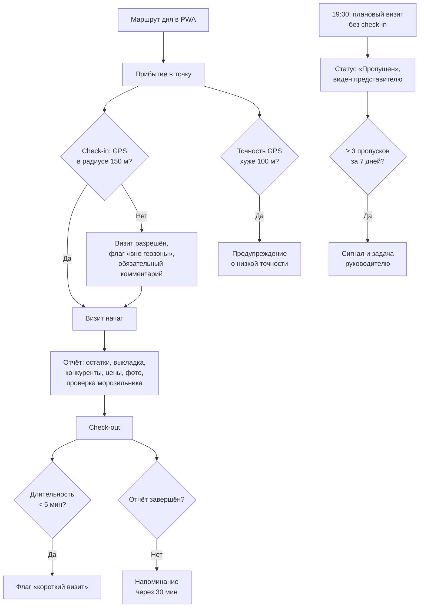
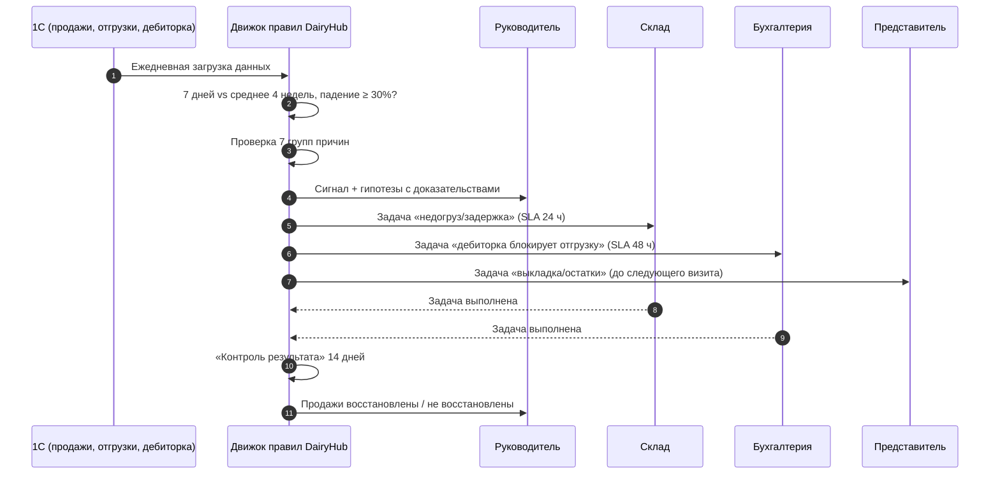
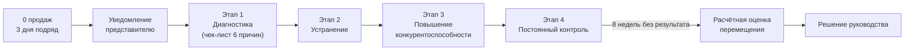

# 02. Бизнес-требования (ТЗ бизнес-аналитика)

| Атрибут | Значение |
|---|---|
| Продукт | DairyHub |
| Версия документа | 1.0 |
| Автор | Бизнес-аналитик проекта |
| Статус | На согласовании |
| Связанные документы | [01 — Концепция](01-concept.md), [03 — Системный анализ](03-system-analysis.md), [06 — План тестирования](06-qa-test-plan.md) |

Нумерация требований: **BR** — бизнес-требования, **US** — пользовательские истории, **FR** — функциональные требования, **NFR** — нефункциональные требования. Приоритеты по MoSCoW: **M** — Must, **S** — Should, **C** — Could, **W** — Won't (в текущей фазе).

---

## 1. Стейкхолдеры

| ID | Стейкхолдер | Интерес | Влияние | Участие в проекте |
|---|---|---|---|---|
| SH-01 | Собственник / генеральный директор | Рост управляемости продаж, окупаемость инвестиций 30 млн ₸ | Высокое | Спонсор, утверждение бюджета и этапов |
| SH-02 | Коммерческий директор | Выполнение плана продаж, прозрачность команды | Высокое | Владелец продукта со стороны бизнеса |
| SH-03 | Руководители / супервайзеры | Контроль визитов, быстрые причины падений | Высокое | Ключевые пользователи, участники UAT |
| SH-04 | Торговые представители | Простота, справедливая оценка, меньше бумажной работы | Среднее (массовое) | Пользователи PWA, пилотная группа |
| SH-05 | Заведующий складом / логистика | Понятные задачи, отсутствие хаотичных запросов | Среднее | Исполнитель задач, источник данных об отгрузках |
| SH-06 | Главный бухгалтер / кредитный контроль | Контроль дебиторки, корректные блокировки | Среднее | Исполнитель задач, источник данных о дебиторке |
| SH-07 | ИТ / администратор 1С | Стабильность интеграции, безопасность | Среднее | Интеграция, администрирование |
| SH-08 | Сервисная организация (ремонт оборудования) — внешний подрядчик, не пользователь системы; заявки ей передаёт руководитель | Своевременные заявки по морозильникам | Низкое | Получатель задач по оборудованию |
| SH-09 | Юрист / ответственный за персональные данные | Соответствие Закону РК «О персональных данных и их защите» | Среднее | Согласование обработки ПДн, GPS, фото |

## 2. Роли пользователей

| Код | Роль | Основные задачи в системе | Интерфейс |
|---|---|---|---|
| `rep` | Торговый представитель | Маршрут, визиты, отчёты, фото, морозильники, свои задачи и план | PWA (смартфон) |
| `manager` | Руководитель / супервайзер | Сигналы, причины, задачи команды, планы, контроль визитов, оборудование | Веб-панель + PWA |
| `warehouse` | Склад | Задачи по отгрузкам, комментарии, закрытие | Веб-панель |
| `accounting` | Бухгалтерия | Задачи по дебиторке, комментарии, закрытие | Веб-панель |
| `admin` | Администратор | Компания, пользователи, приглашения, справочники, аудит, настройки порогов | Веб-панель |

## 3. Бизнес-требования верхнего уровня

| ID | Бизнес-требование | Проблема |
|---|---|---|
| BR-01 | Компания должна иметь достоверные данные о фактических визитах представителей (факт, время, место, длительность, отчёт) | П1 |
| BR-02 | Падение продаж по точке/SKU/представителю должно обнаруживаться автоматически не позднее следующего дня после выполнения условия | П2 |
| BR-03 | Причина отклонения должна устанавливаться по данным всех подразделений, а задача — передаваться ответственному подразделению с SLA | П2 |
| BR-04 | План продаж по точке должен рассчитываться прозрачно, а выполнение — оцениваться справедливо, без учёта потерь не по вине представителя | П3 |
| BR-05 | Все морозильники компании должны быть учтены в едином реестре с подтверждением наличия и контролем состояния | П4 |
| BR-06 | Морозильники без продаж должны выявляться автоматически и проходить формализованную программу восстановления | П5 |
| BR-07 | Персональные данные пользователей должны храниться и обрабатываться на территории РК | Регуляторное |

## 4. Процессы AS-IS и TO-BE

### 4.1. Контроль визитов

**AS-IS.** Представитель получает список точек устно или в мессенджере; факт визита подтверждается его словами или фото в чате; руководитель не видит пропусков, пока не позвонит владелец магазина.

**TO-BE.**

### 4.2. Реакция на падение продаж

**AS-IS.** Руководитель видит итог за месяц; на планёрке выясняет причины; представитель оправдывается; склад и бухгалтерия узнают о проблеме последними или не узнают вовсе.

**TO-BE.**

### 4.3. Планирование и оценка

**AS-IS.** План задаётся процентом роста к прошлому году «на всю территорию»; выполнение считается по отгрузкам без учёта, почему они не состоялись.

**TO-BE.** План по точке рассчитывается системой и утверждается руководителем; выполнение показывается в двух видах — фактическое и скорректированное; шкала премирования (80/100/120%) видна представителю в реальном времени.

### 4.4. Учёт морозильников

**AS-IS.** Учёт в Excel или в 1С как основное средство без привязки к фактическому месту; сведения о поломках приходят с опозданием.

**TO-BE.** Реестр с привязкой к точке и серийным номером; фото морозильника на каждом визите; отметка «Оборудование отсутствует» создаёт сигнал и задачу; датчики температуры на выбранных морозильниках; процесс В работе → Ремонт → Замена → Списание.

### 4.5. Морозильник без продаж

**AS-IS.** Пустые морозильники выявляются при инвентаризации или не выявляются; решения о перемещении принимаются без расчёта.

**TO-BE.**

## 5. Пользовательские истории и критерии приёмки

### 5.0. Доступ и регистрация

**US-00.1** Как первый пользователь компании, я хочу создать рабочее пространство компании, чтобы стать её администратором.

- **Given** пользователь не зарегистрирован, **When** он заполняет название компании, имя, e-mail/телефон и пароль, удовлетворяющий политике, **Then** создаётся компания и пользователь с ролью `admin`.
- **Given** пароль короче 8 символов или не содержит одновременно букв и цифр, **When** пользователь отправляет форму, **Then** регистрация отклоняется с пояснением требований.

**US-00.2** Как администратор, я хочу выдать код приглашения с заранее заданной ролью, чтобы сотрудник присоединился к компании с правильными правами.

- **Given** администратор создал приглашение с ролью `warehouse`, **When** сотрудник регистрируется с этим кодом, **Then** он присоединяется к компании с ролью `warehouse` и не может выбрать другую роль.
- **Given** код приглашения отозван или истёк, **When** сотрудник его вводит, **Then** регистрация отклоняется.

**US-00.3** Как пользователь, я хочу, чтобы мою учётную запись нельзя было подобрать перебором.

- **Given** 4 неудачные попытки входа, **When** пользователь ошибается в 5-й раз, **Then** учётная запись блокируется на 15 минут, и даже верный пароль в этот период не принимается.
- **Given** пользователь вошёл без «Запомнить меня», **When** прошло 12 часов, **Then** сессия завершается. **Given** с «Запомнить меня», **Then** сессия действительна 30 дней.

**US-00.4** Как администратор, я хочу блокировать пользователей и сбрасывать пароли.

- **Given** пользователь заблокирован администратором, **When** он пытается войти или использует действующую сессию, **Then** доступ запрещён.

### 5.1. Проблема П1 — контроль визитов

**US-01.1** Как представитель, я хочу отметить начало визита одним нажатием, чтобы не тратить время на отчёты о присутствии.

- **Given** представитель находится в 80 м от координат точки, **When** он нажимает «Начать визит», **Then** визит переходит в статус «В процессе», фиксируются время, координаты и точность GPS, флагов нет.
- **Given** представитель находится в 400 м от точки, **When** он нажимает «Начать визит», **Then** система требует комментарий, визит начинается с флагом «вне геозоны».
- **Given** точность GPS 180 м, **When** выполняется check-in, **Then** показывается предупреждение о низкой точности, а значение точности сохраняется в визите.

**US-01.2** Как руководитель, я хочу видеть короткие визиты, чтобы понимать качество работы в точке.

- **Given** check-in в 10:00:00 и check-out в 10:04:30, **When** визит завершается, **Then** он помечается флагом «короткий визит».

**US-01.3** Как руководитель, я хочу получать сигнал о систематических пропусках визитов, а не о каждом единичном случае.

- **Given** визит запланирован на сегодня и check-in не выполнен, **When** наступает 19:00 (конец рабочего дня), **Then** визит получает статус «Пропущен» и отображается представителю.
- **Given** у представителя 2 пропущенных визита за последние 7 дней, **When** в 19:00 фиксируется третий, **Then** создаётся один агрегированный сигнал по представителю, руководитель уведомляется и получает задачу.
- **Given** сигнал по представителю уже открыт, **When** фиксируется четвёртый пропуск в окне 7 дней, **Then** новый сигнал не создаётся, существующий дополняется.

**US-01.4** Как представитель, я хочу получать напоминание о незаполненном отчёте.

- **Given** визит завершён (check-out) без завершённого отчёта, **When** прошло 30 минут, **Then** представитель получает напоминание. **And** в 18:00 он получает итоговое напоминание о всех незаполненных отчётах за день.

**US-01.5** Как представитель без связи, я хочу провести визит офлайн.

- **Given** нет сети, **When** представитель выполняет check-in, отчёт и фото, **Then** данные сохраняются на устройстве с исходными метками времени и координатами и синхронизируются при появлении сети.

### 5.2. Проблема П2 — падение продаж и межотдельная цепочка

**US-02.1** Как руководитель, я хочу автоматически узнавать о падении продаж.

- **Given** по точке/SKU среднее недельное за предыдущие 4 недели = 100 единиц, а за последние 7 дней = 65, **When** выполняется ежедневный расчёт, **Then** создаётся сигнал «Падение продаж 35%».
- **Given** падение 25%, **Then** сигнал не создаётся.

**US-02.2** Как руководитель, я хочу видеть гипотезы о причинах с доказательствами.

- **Given** сигнал о падении, **And** за период 2 из 3 отгрузок были недогружены, **When** движок проверяет причины, **Then** создаётся гипотеза «Недогруз/задержка отгрузки» со ссылками на отгрузки и уровнем уверенности.
- **Given** в отчёте визита отмечена акция конкурента, **Then** создаётся гипотеза «Активность конкурента».
- **Given** индекс цены > 110% к конкуренту, **Then** создаётся гипотеза «Неконкурентная цена».

**US-02.3** Как склад, я хочу получать задачи, связанные с конкретной точкой и падением продаж.

- **Given** подтверждена гипотеза «задержка/недогруз», **Then** задача назначается подразделению «Склад» со сроком 24 ч, ссылкой на сигнал и доказательства.

**US-02.4** Как бухгалтерия, я хочу получать задачи, когда дебиторка блокирует отгрузку в точку с падением продаж.

- **Given** у точки просроченная дебиторка и отгрузки заблокированы, **Then** задача назначается «Бухгалтерии» со сроком 48 ч.

**US-02.5** Как руководитель, я хочу видеть, восстановились ли продажи после выполнения задач.

- **Given** все задачи сигнала закрыты, **Then** сигнал переходит в «Контроль результата» на 14 дней, и по их окончании фиксируется результат: «Восстановлено» или «Не восстановлено» (с повторным анализом).

**US-02.6** Как исполнитель, я хочу отклонить ошибочную гипотезу с комментарием, чтобы система не перекладывала на меня чужую проблему.

- **Given** гипотеза назначена складу, **When** склад отклоняет её с комментарием и доказательством, **Then** гипотеза получает статус «Отклонена», руководитель уведомляется.

### 5.3. Проблема П3 — справедливый план

**US-03.1** Как руководитель, я хочу получить расчётный план по точке.

- **Given** средние продажи точки за 3 мес = 1 000 000 ₸, коэффициент сезонности 1,05, категория A (1,10), **When** рассчитывается план, **Then** план = 1 000 000 × 1,05 × 1,10 = 1 155 000 ₸ (ограничение плана сверху в текущей реализации не применяется; в продуктовой версии — по решению компании).

**US-03.2** Как представитель, я хочу, чтобы потери из-за склада и дебиторки не снижали мою оценку.

- **Given** первая проблемная поставка в текущем месяце (задержка, недогруз или блокировка по дебиторке) была 10-го числа, базовая дневная выручка точки (средняя за дни T−35…T−8) = 50 000 ₸, а фактическая выручка 10–14-го = 30 000, 35 000, 60 000, 40 000, 50 000 ₸, **When** считаются извинительные потери, **Then** они равны 20 000 + 15 000 + 0 + 10 000 + 0 = 45 000 ₸ (дни с выручкой выше базовой в минус не идут).
- **Given** план 1 000 000 ₸, факт 760 000 ₸, извинительные потери 90 000 ₸, **When** считается выполнение, **Then** фактическое = 76%, скорректированное = 760 000 / (1 000 000 − 90 000) ≈ 83,5%, и представитель попадает в уровень премирования 80%.

**US-03.3** Как представитель, я хочу видеть, сколько осталось до следующего уровня премирования (80/100/120%).

- **Given** скорректированное выполнение 93%, **Then** экран показывает текущий уровень 80% и остаток до 100% в тенге. Суммы премий отображаются только если компания их задала.

### 5.4. Проблема П4 — морозильники

**US-04.1** Как представитель, я хочу подтверждать наличие морозильника фото на визите.

- **Given** в точке закреплён морозильник, **When** представитель проводит визит, **Then** отчёт требует фото морозильника и подтверждение серийного номера.

**US-04.2** Как руководитель, я хочу сразу узнавать об отсутствии оборудования.

- **Given** представитель отметил «Оборудование отсутствует», **Then** создаётся сигнал руководителю и задача на выяснение.

**US-04.3** Как руководитель, я хочу узнавать о перегреве морозильника, чтобы вызвать сервисную организацию.

- **Given** датчик показывает > −15 °C непрерывно более 2 часов, **Then** создаётся сигнал руководителю, задача руководителю (вызвать сервис) и параллельная задача представителю — проверить крышку и питание (до следующего визита). **Given** −16 °C, **Then** сигнал не создаётся (но значение вне нормы ≤ −18 °C отображается как предупреждение на графике).

**US-04.4** Как руководитель, я хочу вести ремонт/замену оборудования.

- **Given** морозильник в статусе «В работе», **When** создаётся заявка на ремонт, **Then** статус «Ремонт»; далее «Замена» или возврат в «В работе»; «Списание» — финальный статус.

### 5.5. Проблема П5 — морозильник без продаж

**US-05.1** Как представитель, я хочу получать уведомление о морозильнике без продаж.

- **Given** по точке с морозильником продажи замороженной продукции = 0 три дня подряд, **Then** представитель получает уведомление и запускается этап 1 «Диагностика».

**US-05.2** Как представитель, я хочу пройти диагностику по чек-листу.

- **Given** этап «Диагностика», **When** представитель отмечает причины из 6 (нет продукции, неправильная выкладка, низкий спрос, неконкурентная цена, недостаточная работа представителя, конкурентное давление), **Then** создаются действия этапа «Устранение» по каждой отмеченной причине.

**US-05.3** Как руководство, я хочу получить расчёт для решения о перемещении.

- **Given** с начала программы прошло ≥ 56 дней и выручка мороженого в точке за последние 30 дней < 120 000 ₸ (настраиваемый порог компании), **Then** система рассчитывает оценку перемещения: для каждого кандидата `score = 0,55 × (потенциал / макс. потенциал кандидатов) + 0,30 × категория (A 1 / B 0,7 / C 0,3) + 0,15 × max(0, 1 − км/15)`, где потенциал = выручка молочной продукции за 30 дней × 0,19, и показывает ранжированный список рядом с текущей точкой. Перемещение не выполняется автоматически.
- **Given** прошло 55 дней, **Then** оценка не рассчитывается.

## 6. Функциональные требования

### 6.1. Учётные записи и доступ (AUTH)

| ID | Требование | Приоритет |
|---|---|---|
| FR-001 | Регистрация первой учётной записи создаёт компанию (рабочее пространство); пользователь получает роль `admin` | M |
| FR-002 | Администратор создаёт коды приглашения с предопределённой ролью, сроком действия 7 дней и возможностью отзыва | M |
| FR-003 | Пароль: не менее 8 символов, обязательно буквы и цифры | M |
| FR-004 | 5 неудачных попыток входа подряд → блокировка учётной записи на 15 минут | M |
| FR-005 | Сессия действует 12 ч; при «Запомнить меня» — 30 дней | M |
| FR-006 | Администратор может заблокировать/разблокировать пользователя и сбросить пароль | M |
| FR-007 | Права доступа определяются ролью (RBAC, см. [03, раздел 7](03-system-analysis.md)) | M |
| FR-008 | Все действия по доступу пишутся в журнал аудита | M |

### 6.2. Маршруты и визиты (VIS)

| ID | Требование | Приоритет |
|---|---|---|
| FR-010 | Представитель видит маршрут дня со списком плановых визитов и картой | M |
| FR-011 | Check-in фиксирует время, координаты, точность GPS; расстояние до точки вычисляется системой | M |
| FR-012 | Если расстояние > 150 м — визит разрешён, флаг «вне геозоны», комментарий обязателен | M |
| FR-013 | Если точность GPS хуже 100 м — предупреждение пользователю, значение сохраняется | M |
| FR-014 | Длительность визита = check-out − check-in; < 5 мин → флаг «короткий визит» | M |
| FR-015 | Плановый визит без check-in к 19:00 → статус «Пропущен» (виден представителю); сигнал агрегируется по представителю за скользящие 7 дней, при ≥ 3 пропусках — уведомление руководителю и задача | M |
| FR-016 | Отчёт визита: остатки по SKU, out-of-stock, выкладка, цены конкурентов, активность конкурентов, фото, проверка морозильника | M |
| FR-017 | Отчёт не завершён через 30 мин после check-out → напоминание; итоговое напоминание в 18:00 | M |
| FR-018 | Визиты и отчёты доступны офлайн с последующей синхронизацией | M |
| FR-019 | Руководитель формирует и корректирует маршруты представителей | S |

### 6.3. Сигналы и движок причин (SIG)

| ID | Требование | Приоритет |
|---|---|---|
| FR-030 | Ежедневный расчёт: продажи за последние 7 дней vs среднее недельное за предыдущие 4 недели, в разрезах точка / SKU / представитель | M |
| FR-031 | Падение ≥ 30% → сигнал «Падение продаж»; на уровне SKU — только при базе ≥ 14 ед./нед. | M |
| FR-031a | Падение выручки представителя по незамороженной продукции ≥ 30% (7 дней vs среднее 4 недель) → один сигнал уровня представителя; сигналы точек этого представителя сворачиваются в него | M |
| FR-032 | Для сигнала проверяются причины: пропущенные/короткие визиты; out-of-stock в отчётах; задержки/недогрузы отгрузок; просроченная дебиторка, блокирующая отгрузки; активность конкурентов; индекс цены > 110%; морозильник отсутствует/сломан/температура | M |
| FR-033 | Каждая сработавшая причина → гипотеза с доказательствами (ссылки на записи) и уровнем уверенности | M |
| FR-034 | Гипотеза маршрутизирует задачу ответственному подразделению по матрице маршрутизации | M |
| FR-035 | Исполнитель может отклонить гипотезу с обязательным комментарием | M |
| FR-036 | После закрытия всех задач сигнал находится в «Контроль результата» 14 дней, затем закрывается с результатом | M |
| FR-037 | Дубликаты сигналов по одной точке/SKU/типу при открытом сигнале не создаются (обновляется существующий) | M |
| FR-038 | Пороги правил настраиваются администратором; изменения логируются | S |

### 6.4. Задачи (TSK)

| ID | Требование | Приоритет |
|---|---|---|
| FR-040 | Задача содержит: источник (сигнал/гипотеза), точку, подразделение-исполнитель, исполнителя, срок, статус, комментарии, вложения | M |
| FR-041 | SLA по умолчанию: Склад 24 ч, Бухгалтерия 48 ч, Руководитель 48 ч, Представитель — до следующего планового визита в точку | M |
| FR-042 | Просрочка SLA → уведомление исполнителю и руководителю, отметка «просрочено» | M |
| FR-043 | Задачи создаются автоматически (из гипотез) и вручную (руководителем) | M |

### 6.5. Планы и выполнение (PLN)

| ID | Требование | Приоритет |
|---|---|---|
| FR-050 | План точки = среднемесячные продажи за 3 мес × коэффициент сезонности × коэффициент потенциала (A 1,10 / B 1,00 / C 0,95). Ограничение сверху (cap) — в продуктовой версии, по решению компании | M |
| FR-051 | Руководитель может утвердить или скорректировать расчётный план с комментарием | M |
| FR-052 | Скорректированное выполнение = факт / (план − извинительные потери); извинительные потери = Σ max(0, базовая дневная выручка − фактическая) за дни с первой проблемной поставки (задержка / недогруз / блокировка) в текущем месяце; базовая — средняя за T−35…T−8. Подтверждение потерь руководителем — в продуктовой версии | M |
| FR-053 | Пороги премирования 80% / 100% / 120%; суммы задаются компанией в настройках | M |
| FR-054 | Представитель видит фактическое и скорректированное выполнение, текущий уровень и остаток до следующего | M |

### 6.6. Оборудование (FRZ)

| ID | Требование | Приоритет |
|---|---|---|
| FR-060 | Реестр морозильников: серийный номер, модель, точка, дата установки, статус, фото | M |
| FR-061 | Фотоверификация морозильника на каждом визите в точку с оборудованием | M |
| FR-062 | «Оборудование отсутствует» → сигнал руководителю + задача | M |
| FR-063 | Жизненный цикл: В работе → Ремонт → Замена → Списание | M |
| FR-064 | Приём телеметрии с датчиков; норма ≤ −18 °C; > −15 °C дольше 2 ч → сигнал и задача руководителю (вызов сервисной организации) + параллельная задача представителю «проверить крышку и питание» | M |
| FR-065 | График температуры по морозильнику | S |

### 6.7. Морозильник без продаж (FNS)

| ID | Требование | Приоритет |
|---|---|---|
| FR-070 | 0 продаж 3 дня подряд по точке с морозильником → уведомление представителю, старт программы | M |
| FR-071 | Этап 1 «Диагностика» — чек-лист из 6 причин | M |
| FR-072 | Этапы 2–4 с действиями, ответственными и датами | M |
| FR-073 | Не ранее 56 дней программы, если выручка мороженого за 30 дней < 120 000 ₸ (настраиваемый порог), — расчётная оценка перемещения по формуле из [03, BRL-FNS-07](03-system-analysis.md#57-морозильник-без-продаж) (потенциал, категория трафика, близость по маршруту) | M |
| FR-074 | Решение о перемещении принимает руководство; система фиксирует решение и основание | M |

### 6.8. Уведомления, аналитика, администрирование

| ID | Требование | Приоритет |
|---|---|---|
| FR-080 | Каналы уведомлений: в приложении, web push, Telegram-бот, SMS (для критичных) | M (в приложении, push), S (Telegram), C (SMS) |
| FR-081 | Пользователь настраивает каналы; критичные уведомления нельзя отключить полностью | S |
| FR-082 | Дашборд руководителя: визиты, сигналы, задачи по SLA, выполнение плана, оборудование | M |
| FR-083 | Экспорт отчётов в XLSX/CSV | S |
| FR-084 | Справочники: точки (координаты, категория A/B/C), SKU, подразделения, коэффициенты сезонности | M |
| FR-085 | Журнал аудита значимых действий с фильтрами | M |

### 6.9. Раздел «Администрирование» (ADM)

Раздел доступен только администратору.

| ID | Требование | Приоритет |
|---|---|---|
| FR-090 | Список пользователей компании с ролью, статусом и датой последнего входа | M |
| FR-091 | Создание приглашений: код, роль, срок действия 7 дней; отзыв | M |
| FR-092 | Смена роли пользователя (нельзя оставить компанию без администратора) | M |
| FR-093 | Блокировка / разблокировка пользователя | M |
| FR-094 | Сброс пароля с выдачей временного пароля и обязательной сменой при входе | M |
| FR-095 | «Войти как» для поддержки: просмотр системы от имени пользователя; начало, окончание и действия фиксируются в журнале аудита | S |
| FR-096 | Журнал аудита с фильтрами | M |
| FR-097 | Настройка порогов правил с записью изменений в аудит | S |

## 7. Нефункциональные требования

| ID | Категория | Требование | Метод проверки |
|---|---|---|---|
| NFR-01 | Производительность | p95 времени ответа API для операций представителя ≤ 500 мс при штатной нагрузке; загрузка экрана маршрута на 4G ≤ 3 с | Нагрузочный тест (k6), RUM |
| NFR-02 | Производительность | Ежедневный расчёт правил для всей базы точек завершается до 07:00 местного времени | Мониторинг длительности задач |
| NFR-03 | Масштабируемость | Архитектура поддерживает рост числа пользователей и точек в 5 раз без переработки | Нагрузочный тест с ×5 данными |
| NFR-04 | Офлайн | Маршрут, карточки точек, создание визитов, отчётов и фото доступны без сети; автоматическая синхронизация; данные не теряются при закрытии приложения | e2e-тест в режиме offline |
| NFR-05 | Офлайн | Метки времени визита берутся с устройства и проверяются сервером на правдоподобие (расхождение с серверным временем фиксируется) | Интеграционный тест |
| NFR-06 | Доступность | Доступность сервиса ≥ 99,5% в рабочее время (08:00–20:00, пн–сб) | Мониторинг uptime |
| NFR-07 | Надёжность | RPO ≤ 15 мин, RTO ≤ 4 ч | Учения по восстановлению |
| NFR-08 | Безопасность | Соответствие OWASP ASVS уровня 2 для ключевых контролей | Аудит безопасности, SAST/DAST |
| NFR-09 | Безопасность | TLS 1.2+ для всех соединений; шифрование данных и бэкапов в покое | Конфигурационный аудит |
| NFR-10 | Безопасность | Пароли — только в виде стойкого хэша (Argon2id/PBKDF2); политика паролей и блокировки по FR-003–FR-005 | Тест |
| NFR-11 | Аудит | Журнал аудита неизменяемый для пользователей, хранится не менее 1 года (уточняется юристом) | Проверка |
| NFR-12 | Резидентность данных | Персональные данные (ФИО, контакты, GPS-координаты, фото с людьми) хранятся и обрабатываются в базах, расположенных на территории РК, в соответствии с Законом РК «О персональных данных и их защите» | Проверка размещения, договор с провайдером |
| NFR-13 | ПДн | Сбор согласий сотрудников на обработку ПДн и геолокации; GPS собирается только во время рабочих действий (check-in/check-out), без непрерывного трекинга вне рабочего времени | Юридическое согласование, ревью кода |
| NFR-14 | Удобство | Ключевое действие (check-in) — не более 2 нажатий с экрана маршрута; интерфейс соответствует принципам Apple Human Interface Guidelines; минимальная зона нажатия 44×44 pt | UX-ревью, юзабилити-тест |
| NFR-15 | Совместимость | iOS Safari (2 последние мажорные версии), Android Chrome (2 последние), десктоп Chrome/Edge/Firefox/Safari | Матрица устройств |
| NFR-16 | Локализация | Интерфейс на русском языке; архитектура допускает добавление казахского языка | Ревью |
| NFR-17 | Наблюдаемость | Метрики, логи, трассировка, алерты на ошибки и деградацию | Проверка дашбордов |
| NFR-18 | Сопровождаемость | Покрытие unit-тестами движка правил ≥ 90% строк; общая ≥ 70% | CI-отчёт |

## 8. Допущения и ограничения

### 8.1. Допущения

| ID | Допущение | Последствие, если неверно |
|---|---|---|
| AS-01 | В 1С доступны данные о продажах, отгрузках (включая плановые/фактические даты и количества), остатках и дебиторке, и их можно выгружать ежедневно | Движок причин теряет часть гипотез; нужен доработка 1С |
| AS-02 | Координаты точек можно собрать или уточнить при первых визитах | Рост доли «вне геозоны» в начале пилота |
| AS-03 | У представителей есть смартфоны с GPS и мобильный интернет (компенсирует компания или BYOD) | Дополнительные расходы на устройства — вне текущего бюджета |
| AS-04 | Цены конкурентов собираются представителями в отчётах визитов | Индекс цены рассчитывается только по точкам с данными |
| AS-05 | Компания определит коэффициенты сезонности, категории точек и суммы премий до М3 | Задержка модуля планов |
| AS-06 | Для пилота выбирается ограниченная группа представителей/территория | Масштаб пилота уточняется на М1 |

### 8.2. Ограничения

| ID | Ограничение |
|---|---|
| CN-01 | Бюджет — 30 млн ₸ (из них разработка — 9 млн ₸), срок — 6 месяцев |
| CN-02 | Хранение ПДн — только на территории РК |
| CN-03 | Приложение представителя — PWA (без публикации в магазинах приложений на этапе проекта) |
| CN-04 | Датчики температуры ставятся на выбранные морозильники, а не на весь парк |
| CN-05 | DairyHub не ведёт учёт вместо 1С; 1С остаётся мастер-системой по заказам, отгрузкам и дебиторке |

## 9. KPI проекта и их измерение на пилоте

Базовые значения замеряются на М1 (за последние 4–8 недель до пилота, по имеющимся данным) или в контрольной группе. Целевые значения утверждаются Управляющим комитетом на М1 и **не являются обещанием роста продаж**.

| ID | KPI | Формула | Источник данных | Частота |
|---|---|---|---|---|
| KPI-01 | Доля выполненных плановых визитов | Визиты с check-in / плановые визиты | DairyHub | Ежедневно |
| KPI-02 | Доля визитов в геозоне | Визиты без флага «вне геозоны» / все визиты | DairyHub | Еженедельно |
| KPI-03 | Доля коротких визитов | Визиты < 5 мин / все визиты | DairyHub | Еженедельно |
| KPI-04 | Своевременность отчётов | Отчёты завершены в течение 30 мин после check-out / все визиты | DairyHub | Еженедельно |
| KPI-05 | Время реакции на падение | Медиана (создание первой задачи − дата выполнения условия падения) | DairyHub | Еженедельно |
| KPI-06 | Соблюдение SLA | Задачи, закрытые в SLA / все закрытые задачи, по подразделениям | DairyHub | Еженедельно |
| KPI-07 | Доля восстановленных сигналов | Сигналы с результатом «Восстановлено» после 14 дней / закрытые сигналы | DairyHub + 1С | Ежемесячно |
| KPI-08 | Распределение подтверждённых причин | Доли по типам причин | DairyHub | Ежемесячно |
| KPI-09 | Подтверждённость реестра оборудования | Морозильники с фото-подтверждением за последние 30 дней / все активные | DairyHub | Ежемесячно |
| KPI-10 | Морозильники без продаж | Число и доля; доля, вышедших из программы с продажами | DairyHub + 1С | Еженедельно |
| KPI-11 | Активность пользователей | Активные представители в день / все представители пилота | DairyHub | Ежедневно |
| KPI-12 | Удовлетворённость / справедливость | Опрос (шкала 1–5) до и после пилота | Опрос | 2 раза |
| KPI-13 | Динамика продаж пилотной группы | Изменение продаж пилота vs контрольная группа (difference-in-differences) | 1С | По итогам пилота |

> KPI-13 измеряется, но **не используется как критерий приёмки проекта**: на продажи влияют сезонность, цены и конкуренты, и короткий пилот не позволяет надёжно выделить эффект платформы.

## 10. Риски (бизнес-уровень)

Полный реестр рисков — в [05 — План проекта](05-project-plan.md#9-реестр-рисков).

| ID | Риск | Вероятность | Влияние | Митигация |
|---|---|---|---|---|
| R-01 | Сопротивление представителей («слежка») | Высокая | Высокое | Принцип «помогает, а не обвиняет»; скорректированное выполнение; GPS только при действиях; вовлечение в пилот |
| R-02 | Качество и доступность данных 1С | Средняя | Высокое | Аудит данных на М1; валидация при загрузке; ручной ввод как резерв |
| R-03 | Неточные координаты точек | Высокая | Среднее | Уточнение координат на первых визитах с подтверждением руководителя |
| R-04 | Ложные сигналы / «шум» | Средняя | Среднее | Настраиваемые пороги; отклонение гипотез с обратной связью; калибровка на пилоте |
| R-05 | Неисполнение задач смежными отделами | Средняя | Высокое | SLA, эскалации, участие руководителей отделов в Управляющем комитете |
| R-06 | Несоответствие требованиям о ПДн | Низкая | Высокое | Хостинг в РК, согласия, ревью юристом на М1 |
| R-07 | Нехватка бюджета разработки (9 млн ₸) | Средняя | Высокое | Lean-команда, жёсткий MVP-scope, резервный фонд |
