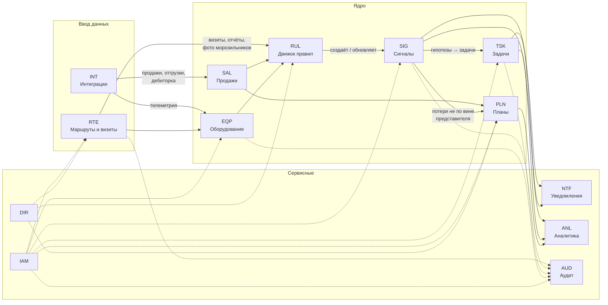
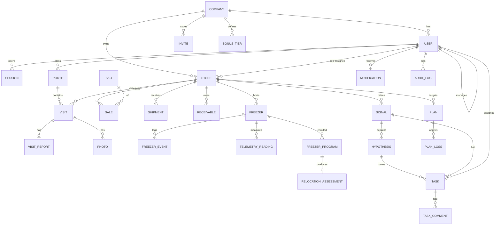
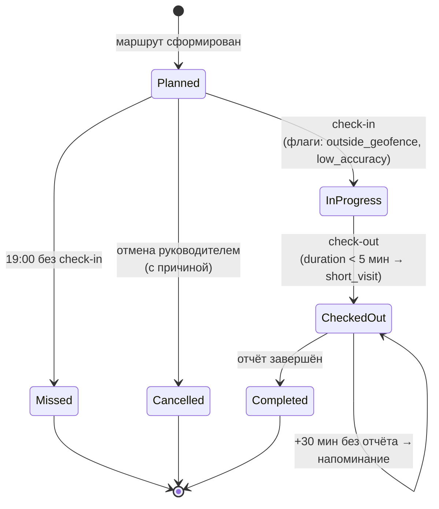
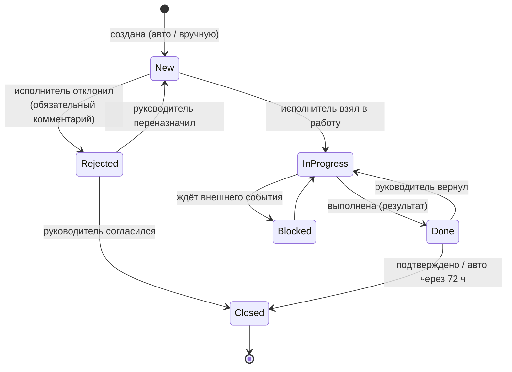
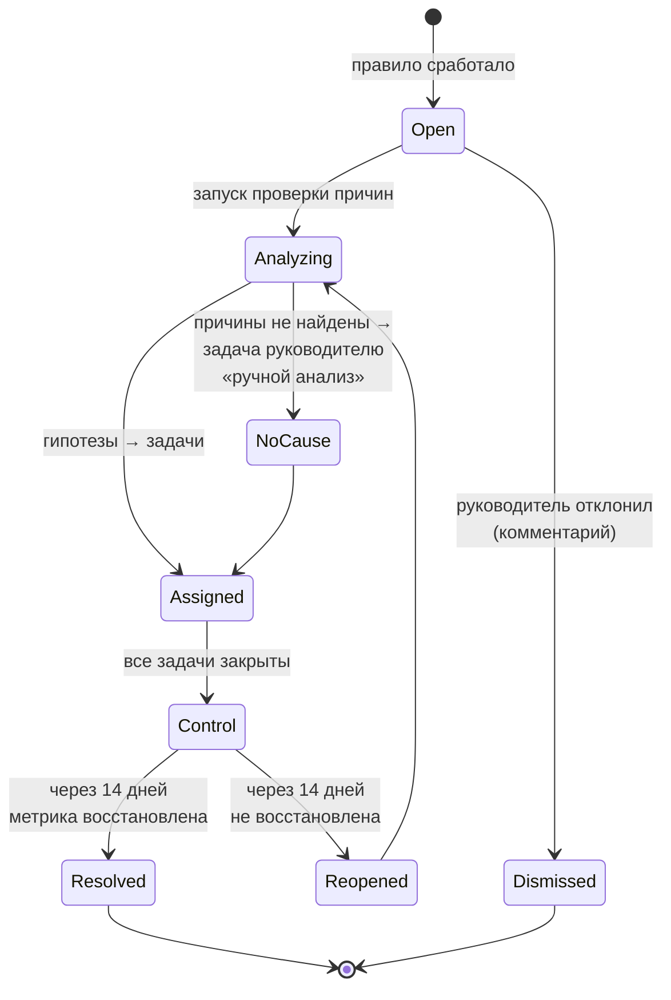
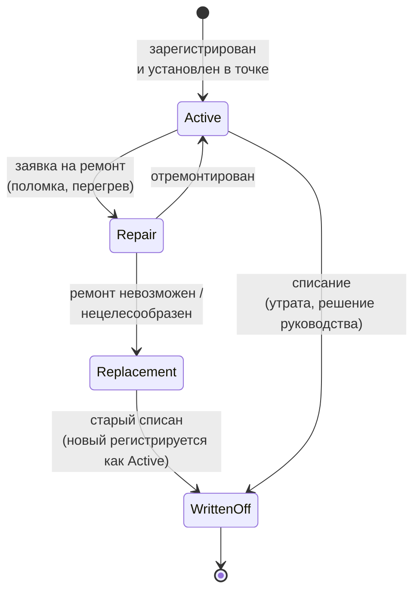
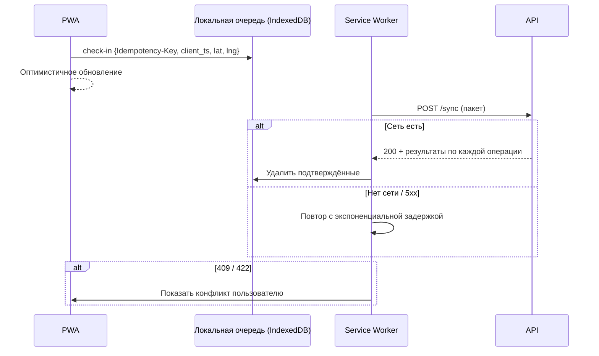

# 03. Системный анализ

| Атрибут | Значение |
|---|---|
| Продукт | DairyHub |
| Версия документа | 1.0 |
| Автор | Системный аналитик проекта |
| Связанные документы | [02 — Бизнес-требования](02-business-requirements.md), [04 — Архитектура](04-architecture.md), [06 — План тестирования](06-qa-test-plan.md) |

Документ переводит бизнес-требования в спецификацию для разработки: модули, данные, состояния, правила с точными порогами, права доступа, API и интеграции. Все пороги в разделе 5 — **исходные значения**, реализованные в приложении; они хранятся как настраиваемые параметры (`rule_settings`) и могут быть изменены администратором с записью в журнал аудита.

---

## 1. Модули системы и их связи

| Код | Модуль | Назначение |
|---|---|---|
| IAM | Идентификация и доступ | Компании, пользователи, роли, приглашения, сессии, блокировки |
| DIR | Справочники | Точки продаж, SKU, подразделения, категории, коэффициенты |
| RTE | Маршруты и визиты | Планирование маршрутов, check-in/out, геозона, отчёты, фото |
| SAL | Данные продаж | Продажи, отгрузки, остатки, дебиторка (из 1С) |
| RUL | Движок правил | Расчёт отклонений, проверка причин, гипотезы, расписание |
| SIG | Сигналы | Жизненный цикл сигналов, гипотезы, контроль результата |
| TSK | Задачи | Задачи, SLA, эскалации, комментарии |
| PLN | Планы | Расчёт планов, выполнение, скорректированное выполнение, уровни премирования |
| EQP | Оборудование | Реестр морозильников, жизненный цикл, телеметрия, программа «без продаж» |
| NTF | Уведомления | Доставка по каналам: в приложении, web push, Telegram, SMS |
| ANL | Аналитика | Дашборды, отчёты, экспорт |
| AUD | Аудит | Неизменяемый журнал значимых действий |
| INT | Интеграции | 1С, датчики (MQTT), файловое хранилище, карты |



## 2. Модель данных

### 2.1. Сущности и ключевые поля

Все сущности содержат `id (uuid)`, `company_id` (изоляция арендаторов), `created_at`, `updated_at`. Ниже — специфичные поля.

| Сущность | Ключевые поля | Примечания |
|---|---|---|
| **Company** | name, timezone (по умолчанию Asia/Almaty), workday_end (19:00), currency (KZT) | Рабочее пространство |
| **User** | full_name, email, phone, role (`rep`/`manager`/`warehouse`/`accounting`/`admin`), password_hash, status (active/blocked), failed_attempts, locked_until, manager_id | `manager_id` — руководитель представителя |
| **Invite** | code, role, expires_at, created_by, used_by, revoked_at | Код одноразовый |
| **Session** | user_id, expires_at, remember_me, ip, user_agent, revoked_at | 12 ч / 30 дней |
| **Store** (точка) | name, address, location (geography Point), category (A/B/C), traffic_category, rep_id, is_active, credit_blocked | Координаты — основа геозоны |
| **Sku** | code (из 1С), name, group (молоко, йогурты, мороженое…), is_frozen | `is_frozen` — для морозильников |
| **Route** | rep_id, date, status | Маршрут дня |
| **Visit** | route_id, store_id, rep_id, planned_date, status, checkin_at, checkin_location, checkin_accuracy_m, checkin_distance_m, checkout_at, duration_s, flags[] (`outside_geofence`, `low_accuracy`, `short_visit`), outside_comment, client_created_at, synced_at | См. state machine 4.1 |
| **VisitReport** | visit_id, status (draft/completed), stock_items[] (sku_id, qty, out_of_stock), display_ok, competitor_activity (bool, note), competitor_prices[] (sku_id, our_price, competitor_price), freezer_check (freezer_id, present, serial_confirmed, photo_id, condition), completed_at | |
| **Photo** | object_key, visit_id, kind (shelf/freezer/other), taken_at, location, sha256 | Файл в S3 |
| **Sale** | date, store_id, sku_id, rep_id, qty, amount_kzt | Из 1С, по дням |
| **Shipment** | store_id, order_ref, planned_date, actual_date, qty_ordered, qty_shipped, status | Из 1С; задержка/недогруз вычисляются |
| **Receivable** (дебиторка) | store_id, amount_kzt, overdue_days, shipment_blocked (bool), as_of_date | Из 1С |
| **Freezer** | serial_number (уник.), model, store_id, installed_at, status, has_sensor, sensor_id, last_verified_at, last_photo_id | |
| **FreezerEvent** | freezer_id, type (verified/missing/repair/replace/writeoff/moved), from_status, to_status, comment, actor_id | История |
| **TelemetryReading** | sensor_id, ts, temperature_c, battery | Гипертаблица TimescaleDB |
| **Signal** | type, store_id, sku_id?, rep_id?, freezer_id?, severity, status, metric_value, baseline_value, detected_at, control_until, outcome, dedup_key | См. 4.3 |
| **Hypothesis** | signal_id, cause_type, confidence (high/medium/low), confidence_score (0–1), evidence[] (entity, id, summary), status (proposed/accepted/rejected), reject_comment | |
| **Task** | signal_id?, hypothesis_id?, store_id, department, assignee_id, title, description, due_at, status, sla_breached, closed_at, resolution | См. 4.2 |
| **TaskComment** | task_id, author_id, text, attachments[] | |
| **Plan** | store_id, rep_id, period (месяц), base_avg_3m, seasonality_coef, potential_coef, calculated_amount, approved_amount, approved_by | `cap_value` — только в продуктовой версии, по решению компании |
| **PlanLoss** | plan_id, reason (`delivery_delay`/`short_delivery`/`debt_block`), first_problem_date, base_daily_kzt, amount_kzt (excused loss), source_ref, confirmed_by | Для скорректированного выполнения; `confirmed_by` — в продуктовой версии |
| **BonusTier** | company_id, threshold_pct (80/100/120), amount_kzt (nullable — задаёт компания) | |
| **FreezerProgram** | freezer_id, store_id, stage (1–4), started_at, diagnosis[] (6 причин), actions[], status, relocation_assessment_id? | Программа «без продаж» |
| **RelocationAssessment** | program_id, current_score, candidates[] (store_id, potential, traffic_category, route_distance_km, score), computed_at, decision, decided_by | Решение — за руководством |
| **Notification** | user_id, channel, type, payload, status, sent_at, read_at | |
| **AuditLog** | actor_id, action, entity, entity_id, before, after, ip, ts | Только добавление |
| **RuleSetting** | key, value, updated_by | Пороги правил |

### 2.2. ER-диаграмма



## 3. Справочник перечислений

| Перечисление | Значения |
|---|---|
| Role | `rep` Торговый представитель · `manager` Руководитель/супервайзер · `warehouse` Склад · `accounting` Бухгалтерия · `admin` Администратор |
| Department (для задач) | `warehouse` Склад · `accounting` Бухгалтерия · `manager` Руководитель · `rep` Торговый представитель. Отдельной роли «Сервис» нет: задачи по оборудованию получает руководитель, который сам вызывает сервисную организацию |
| SignalType | `missed_visit` (агрегированный по представителю за 7 дней), `short_visit`, `outside_geofence`, `report_missing`, `sales_drop` (уровень `scope`: `store`, `store_sku`, `rep`), `freezer_missing`, `freezer_temperature`, `freezer_no_sales` |
| CauseType | `visits` (пропущенные/короткие визиты), `out_of_stock`, `delivery` (задержка/недогруз), `debt_block`, `competitor_activity`, `price_index`, `freezer` |
| FreezerStatus | `active` В работе · `repair` Ремонт · `replacement` Замена · `written_off` Списание |

## 4. Конечные автоматы (state machines)

### 4.1. Визит



| Переход | Условие | Побочные эффекты |
|---|---|---|
| Planned → InProgress | Check-in представителем, закреплённым за визитом | Расчёт расстояния; флаги; при `outside_geofence` комментарий обязателен |
| InProgress → CheckedOut | Check-out | `duration_s`; при < 300 с — флаг `short_visit`, сигнал `short_visit` (информационный) |
| CheckedOut → Completed | Отчёт в статусе `completed` | Отмена отложенного напоминания |
| Planned → Missed | Задание в `workday_end` (19:00, часовой пояс компании) | Визит отображается представителю как пропущенный; пересчёт агрегированного сигнала `missed_visit` по представителю (скользящие 7 дней, порог ≥ 3) |
| InProgress (на 19:00) | Визит не завершён | Остаётся InProgress; при следующей синхронизации — авто-check-out не выполняется, руководитель видит «незакрытый визит» |

### 4.2. Задача



SLA отсчитывается от `New`; статус `Blocked` не останавливает SLA (по умолчанию; может быть изменено решением на М1). Просрочка (`now > due_at` при статусе New/InProgress/Blocked) → `sla_breached = true`, уведомление исполнителю и руководителю.

### 4.3. Сигнал (Alert)



Для информационных сигналов (`short_visit`, `outside_geofence`, `report_missing`) используется упрощённый цикл: `Open → Acknowledged → [*]`.

**Критерий «восстановлено»** для `sales_drop`: продажи за последние 7 дней периода контроля ≥ 90% базового уровня (среднего недельного за 4 недели до сигнала). Значение 90% — исходный параметр `recovery_threshold`, калибруется на пилоте.

### 4.4. Морозильник



| Статус | Отображение | Кто меняет |
|---|---|---|
| `active` | В работе | manager, admin |
| `repair` | Ремонт | manager (по задаче/сигналу) |
| `replacement` | Замена | manager |
| `written_off` | Списание (финальный) | manager с подтверждением admin |

Отметка «Оборудование отсутствует» не меняет статус автоматически: она создаёт сигнал `freezer_missing` и задачу руководителю; изменение статуса — решение человека по итогам выяснения.

## 5. Бизнес-правила

### 5.1. Доступ

| ID | Правило | Параметр |
|---|---|---|
| BRL-AUTH-01 | Первый зарегистрировавшийся пользователь создаёт компанию и получает роль `admin` | — |
| BRL-AUTH-02 | Остальные пользователи присоединяются только по коду приглашения; роль задаётся приглашением | — |
| BRL-AUTH-03 | Пароль ≥ 8 символов, содержит хотя бы одну букву и одну цифру | `password_min_length = 8` |
| BRL-AUTH-04 | 5 неудачных попыток подряд → блокировка 15 мин; успешный вход сбрасывает счётчик | `max_failed_logins = 5`, `lockout_minutes = 15` |
| BRL-AUTH-05 | Сессия 12 ч; «Запомнить меня» — 30 дней | `session_hours = 12`, `remember_days = 30` |
| BRL-AUTH-06 | Блокировка пользователем `admin` немедленно аннулирует все его сессии | — |
| BRL-AUTH-07 | Сброс пароля администратором выдаёт временный пароль с обязательной сменой при входе | — |

### 5.2. Визиты

| ID | Правило | Параметр |
|---|---|---|
| BRL-VIS-01 | Расстояние до точки — геодезическое расстояние между координатами check-in и `Store.location` | — |
| BRL-VIS-02 | Расстояние > 150 м → флаг `outside_geofence`, обязательный комментарий; визит **не блокируется** | `geofence_m = 150` |
| BRL-VIS-03 | Точность GPS > 100 м → предупреждение и флаг `low_accuracy` | `gps_accuracy_warn_m = 100` |
| BRL-VIS-04 | Длительность = `checkout_at − checkin_at`; < 5 мин → флаг `short_visit` | `short_visit_min = 5` |
| BRL-VIS-05 | Плановый визит без check-in к концу рабочего дня → `Missed` | `workday_end = 19:00` |
| BRL-VIS-05a | Сигнал `missed_visit` агрегируется по представителю за скользящие 7 дней (один открытый сигнал на представителя). При ≥ 3 пропущенных визитах за окно уведомляется руководитель и создаётся задача руководителю (SLA 48 ч); новые пропуски в том же окне дополняют существующий сигнал | `missed_window_days = 7`, `missed_alert_count = 3` |
| BRL-VIS-06 | Check-out без завершённого отчёта → напоминание через 30 мин | `report_reminder_min = 30` |
| BRL-VIS-07 | Итоговое напоминание о незавершённых отчётах дня | `daily_summary_at = 18:00` |

### 5.3. Падение продаж и проверка причин

| ID | Правило | Параметр |
|---|---|---|
| BRL-SAL-01 | `current = Σ продаж за последние 7 дней (D-6..D)`; `baseline = Σ продаж за предыдущие 28 дней (D-34..D-7) / 4` | — |
| BRL-SAL-02 | `drop_pct = (baseline − current) / baseline × 100`; расчёт в разрезах точка, точка × SKU, представитель | — |
| BRL-SAL-03 | `drop_pct ≥ 30` → сигнал `sales_drop` | `sales_drop_pct = 30` |
| BRL-SAL-04 | Падение на уровне SKU (точка × SKU) не рассматривается, если `baseline` < 14 единиц в неделю по этому SKU (защита от «шума» малых объёмов) | `min_baseline = 14` ед./нед. на SKU |
| BRL-SAL-04a | Падение на уровне представителя: выручка представителя по незамороженной продукции (`is_frozen = false`) за последние 7 дней vs среднее недельное за предыдущие 4 недели, изменение ≤ −30% → один сигнал `sales_drop` со `scope = rep`. Сигналы уровня точки по точкам этого представителя сворачиваются в него (отображаются как вложенные, отдельные задачи по ним не дублируются) | `sales_drop_pct = 30` |
| BRL-SAL-05 | Ключ дедупликации: `sales_drop:{store}:{sku или *}:{rep}`; при открытом сигнале новый не создаётся, обновляются метрики | — |
| BRL-SAL-06 | После закрытия всех задач — статус `Control` на 14 дней | `control_days = 14` |

**Проверки причин (окно анализа — последние 7 дней, если не указано иное):**

| Код | Причина | Условие срабатывания | Доказательства | Уверенность (исходная калибровка) |
|---|---|---|---|---|
| C1 `visits` | Пропущенные / короткие визиты | Окно 14 дней по точке; обязательное условие для всех критериев — ≥ 2 плановых визитов в окне. Затем: ≥ 2 пропущенных **или** доля пропущенных ≥ 30% **или** ≥ 2 коротких визитов | Список визитов с флагами | high — доля пропущенных ≥ 40%; иначе medium |
| C2 `out_of_stock` | Отсутствие товара на полке | В отчётах визитов отмечен out-of-stock по SKU сигнала (или любому SKU для сигнала по точке) | Отчёты и фото | high — в ≥ 2 отчётах; medium — в 1 |
| C3 `delivery` | Задержка / недогруз отгрузок | Отгрузка с `actual_date > planned_date` или `qty_shipped < qty_ordered` | Отгрузки, разница в днях / количестве | high — затронуто ≥ 50% отгрузок; medium — < 50% |
| C4 `debt_block` | Просроченная дебиторка блокирует отгрузку | `Receivable.shipment_blocked = true` или `overdue_days > 0` и есть отклонённые отгрузки | Сумма, дни просрочки | high — блокировка действует; medium — была в окне |
| C5 `competitor_activity` | Активность конкурентов | В отчётах отмечена активность конкурента | Отчёты, фото, заметки | medium (по умолчанию); high — в ≥ 2 отчётах |
| C6 `price_index` | Неконкурентная цена | `price_index = our_price / competitor_price × 100 > 110` по SKU сигнала | Цены из отчётов | high — > 120; medium — 110–120 |
| C7 `freezer` | Проблемы с морозильником | Отметка «отсутствует», статус `repair`, или телеметрия > −15 °C дольше 2 ч в окне | События и телеметрия | high |

Числовое значение `confidence_score` (0–1) соответствует уровням: high ≥ 0,7; medium 0,4–0,69; low < 0,4. Калибровка порогов уверенности — задача пилота (М5).

### 5.4. Маршрутизация сигналов по подразделениям

| Тип сигнала / причины | Получатель уведомления | Задача назначается | SLA | Эскалация при просрочке |
|---|---|---|---|---|
| `missed_visit` (агрегат по представителю, 7 дней) | Представитель видит пропуски в приложении; при ≥ 3 пропусках — руководитель | При ≥ 3 пропусках — руководитель | 48 ч | Коммерческий директор |
| `short_visit`, `outside_geofence` | Руководитель (в дайджесте) | — | — | — |
| `report_missing` | Представитель | — | — | Руководитель в дайджесте |
| `sales_drop` (scope `rep`) | Руководитель | Руководитель (разбор с представителем; сигналы точек этого представителя свёрнуты в него) | 48 ч | Коммерческий директор |
| `sales_drop` → C1 `visits` | Руководитель | Руководитель | 48 ч | Руководитель руководителя / коммерческий директор |
| `sales_drop` → C2 `out_of_stock` | Представитель | Торговый представитель | До следующего планового визита в точку | Руководитель |
| `sales_drop` → C3 `delivery` | Склад, руководитель | Склад | 24 ч | Руководитель + заведующий складом |
| `sales_drop` → C4 `debt_block` | Бухгалтерия, руководитель | Бухгалтерия | 48 ч | Руководитель + главный бухгалтер |
| `sales_drop` → C5 `competitor_activity` | Руководитель | Руководитель (коммерческое решение) | 48 ч | Коммерческий директор |
| `sales_drop` → C6 `price_index` | Руководитель | Руководитель (коммерческое решение) | 48 ч | Коммерческий директор |
| `sales_drop` → C7 `freezer` | Руководитель, представитель | Руководитель (вызывает сервисную организацию) + параллельная задача представителю: проверить крышку и питание | Руководитель 48 ч; представитель — до следующего визита | Администратор |
| `sales_drop` без причин | Руководитель | Руководитель «ручной анализ» | 48 ч | Коммерческий директор |
| `freezer_missing` | Руководитель | Руководитель | 48 ч | Администратор |
| `freezer_temperature` | Руководитель, представитель | Руководитель (вызывает сервисную организацию) + параллельная задача представителю: проверить крышку и питание | Руководитель 48 ч (рекомендуется сократить на М1); представитель — до следующего визита | Коммерческий директор |
| `freezer_no_sales` | Представитель | Представитель (этап «Диагностика») | До следующего визита | Руководитель |

### 5.5. Планы и выполнение

| ID | Правило |
|---|---|
| BRL-PLN-01 | `base_avg_3m` = среднемесячные продажи точки (₸) за 3 полных предшествующих месяца |
| BRL-PLN-02 | `plan = base_avg_3m × seasonality_coef(месяц) × potential_coef(категория)`; `potential_coef`: A = 1,10; B = 1,00; C = 0,95 |
| BRL-PLN-03 | Ограничение плана сверху в текущей реализации **не применяется**. В продуктовой версии, по решению компании, может быть введён параметр `plan_cap_ratio` (`plan ≤ base_avg_3m × plan_cap_ratio`) |
| BRL-PLN-04 | Коэффициенты сезонности по месяцам задаёт компания (справочник) |
| BRL-PLN-05 | Расчётный план утверждается руководителем; ручная корректировка требует комментария и логируется |
| BRL-PLN-06 | `fact_pct = fact / plan × 100` |
| BRL-PLN-07 | `adjusted_pct = fact / (plan − excused_loss) × 100` |
| BRL-PLN-08 | `excused_loss = Σ max(0, base_daily − actual_daily)` по точке за дни с даты **первой проблемной поставки** в текущем месяце (поставка с задержкой, недогрузом или заблокированная из-за дебиторки) по текущий день. `base_daily` — средняя дневная выручка точки за дни T−35…T−8 (T — текущая дата). В текущей реализации рассчитывается автоматически; подтверждение руководителем — в продуктовой версии |
| BRL-PLN-09 | Уровни премирования по `adjusted_pct`: ≥ 80%, ≥ 100%, ≥ 120%. Суммы премий (`BonusTier.amount_kzt`) задаёт компания; система их не придумывает и не выплачивает |

### 5.6. Оборудование и телеметрия

| ID | Правило | Параметр |
|---|---|---|
| BRL-FRZ-01 | Каждый морозильник уникален по серийному номеру и закреплён ровно за одной точкой (или складом) | — |
| BRL-FRZ-02 | На каждом визите в точку с морозильником отчёт требует фото и подтверждение серийного номера | — |
| BRL-FRZ-03 | «Оборудование отсутствует» → сигнал `freezer_missing` руководителю + задача | — |
| BRL-FRZ-04 | Норма температуры ≤ −18 °C | `temp_normal_max = -18` |
| BRL-FRZ-05 | Температура > −15 °C непрерывно более 2 ч → сигнал `freezer_temperature` руководителю и задача руководителю (вызов сервисной организации) + параллельная задача представителю «проверить крышку и питание» | `temp_alarm = -15`, `temp_alarm_hours = 2` |
| BRL-FRZ-06 | Значения между −18 и −15 °C — предупреждение на графике без сигнала | — |
| BRL-FRZ-07 | Отсутствие данных с датчика > 6 ч — технический сигнал администратору (исходное значение, уточняется по характеристикам датчиков) | `sensor_silence_hours = 6` |

### 5.7. Морозильник без продаж

| ID | Правило | Параметр |
|---|---|---|
| BRL-FNS-01 | Продажи SKU с `is_frozen = true` по точке с активным морозильником = 0 три календарных дня подряд → уведомление представителю, старт программы (этап 1) | `no_sales_days = 3` |
| BRL-FNS-02 | Этап 1 «Диагностика»: чек-лист 6 причин — нет продукции; неправильная выкладка; низкий спрос; неконкурентная цена; недостаточная работа представителя; конкурентное давление | — |
| BRL-FNS-03 | Этап 2 «Устранение»: для каждой отмеченной причины — действие и ответственный (нет продукции → склад/заказ; выкладка → представитель; цена → руководитель и т. д.) | — |
| BRL-FNS-04 | Этап 3 «Повышение конкурентоспособности»: промо-материалы, выкладка, ассортимент | — |
| BRL-FNS-05 | Этап 4 «Постоянный контроль»: еженедельный мониторинг продаж | — |
| BRL-FNS-06 | Оценка перемещения запускается не ранее чем через 56 дней (8 недель) после старта программы, если точка нерентабельна: выручка мороженого за последние 30 дней < 120 000 ₸ | `program_min_days = 56`; `unprofitable_threshold_kzt = 120 000` (настраиваемый параметр компании; значение демо-версии) |
| BRL-FNS-07 | Кандидаты — точки без морозильника на маршрутах того же представителя/территории. Потенциал кандидата = выручка молочной продукции за 30 дней × 0,19 (0,19 — средняя доля мороженого в выручке точек с морозильником). `score = 0,55 × (потенциал / макс. потенциал среди кандидатов) + 0,30 × категория (A = 1; B = 0,7; C = 0,3) + 0,15 × близость`, где `близость = max(0, 1 − км / 15)` (расстояние по маршруту от текущей точки). Текущая точка показывается рядом для сравнения (её фактическая выручка мороженого за 30 дней) | `ice_cream_share = 0,19`; веса 0,55 / 0,30 / 0,15; `proximity_km = 15` (настраиваемые) |
| BRL-FNS-08 | Система только показывает ранжированный список; решение и его основание фиксирует руководство | — |

### 5.8. Администрирование

Раздел «Администрирование» доступен только роли `admin`.

| ID | Функция | Правило |
|---|---|---|
| BRL-ADM-01 | Список пользователей компании | Имя, контакты, роль, статус (активен / заблокирован / временно заблокирован после неудачных входов), дата последнего входа |
| BRL-ADM-02 | Создание приглашений | Генерируется код; роль задаётся при создании; срок действия 7 дней; код одноразовый, может быть отозван (`invite_ttl_days = 7`) |
| BRL-ADM-03 | Смена роли | Применяется немедленно; администратор не может снять роль `admin` с последнего администратора компании |
| BRL-ADM-04 | Блокировка / разблокировка | Блокировка аннулирует все сессии пользователя; разблокировка снимает и временную блокировку после 5 неудачных входов |
| BRL-ADM-05 | Сброс пароля | Выдаётся временный пароль; при первом входе обязательна смена |
| BRL-ADM-06 | «Войти как» (для поддержки) | Администратор открывает сессию от имени пользователя, чтобы увидеть его экран; интерфейс показывает баннер режима; начало и окончание фиксируются в журнале аудита, все действия в этом режиме записываются с указанием администратора |
| BRL-ADM-07 | Журнал аудита | Просмотр с фильтрами по пользователю, действию, сущности и дате; записи не изменяются и не удаляются |
| BRL-ADM-08 | Пороги правил | Просмотр и изменение параметров `rule_settings` (геозона, пороги падения, SLA и т. д.); каждое изменение фиксируется в журнале аудита со старым и новым значением |

### 5.9. Задачи и SLA

| Подразделение | SLA |
|---|---|
| Склад | 24 ч |
| Бухгалтерия | 48 ч |
| Руководитель | 48 ч |
| Торговый представитель | До следующего планового визита в точку |

Напоминание исполнителю — при истечении 75% SLA; при просрочке — уведомление руководителю.

## 6. Расписание правил

| Задание | Время (часовой пояс компании) | Описание |
|---|---|---|
| `import-1c-daily` | 05:00 | Загрузка продаж, отгрузок, дебиторки за прошедший день |
| `rules-sales-drop` | 06:00 | Расчёт падений и причин |
| `rules-freezer-no-sales` | 06:15 | Проверка 3 дней без продаж |
| `rules-control-outcome` | 06:30 | Закрытие сигналов после 14 дней контроля |
| `reminder-report` | через 30 мин после check-out (отложенная задача) | Напоминание об отчёте |
| `reminder-daily-summary` | 18:00 | Итоговое напоминание |
| `rules-missed-visits` | 19:00 | Пропущенные визиты и пересчёт агрегата по представителю за 7 дней |
| `sla-watch` | каждые 15 мин | Проверка SLA задач |
| `telemetry-window` | потоково + каждые 5 мин | Проверка окна 2 ч > −15 °C |

## 7. RBAC-матрица

Обозначения: **C** — создание, **R** — чтение, **U** — изменение, **D** — удаление/архивирование, **own** — только свои/свои точки, **team** — своя команда, **dept** — задачи своего подразделения, — нет доступа.

| Ресурс / действие | rep | manager | warehouse | accounting | admin |
|---|---|---|---|---|---|
| Компания, настройки, пороги правил | — | R | — | — | CRUD |
| Пользователи, приглашения, смена роли, блокировка, сброс пароля | — | R (team) | — | — | CRUD |
| «Войти как» (поддержка, с записью в аудит) | — | — | — | — | U |
| Точки продаж | R (own) | CRU (team) | R | R | CRUD |
| Маршруты | R (own) | CRUD (team) | — | — | R |
| Визиты: check-in/out, отчёт | CRU (own) | R (team), отмена | — | — | R |
| Фото | C, R (own) | R (team) | — | — | R |
| Продажи | R (own) | R (team) | R | R | R |
| Отгрузки | R (own точки) | R | R, U (комментарии) | R | R |
| Дебиторка | R (статус блокировки) | R | — | R | R |
| Сигналы | R (own) | R, U (team) — отклонение, ручной анализ | R (связанные) | R (связанные) | R |
| Гипотезы: принять/отклонить | U (свои задачи) | U | U (dept) | U (dept) | R |
| Задачи | R, U (own) | CRUD (team) | R, U (dept) | R, U (dept) | R |
| Планы: расчёт, утверждение | R (own) | CRU (team) | — | — | R, U (коэффициенты) |
| Суммы премий | R | R | — | R | CRUD |
| Морозильники: реестр | R (own точки), отметка на визите | CRU (team) | R | — | CRUD |
| Статус морозильника | — | U (кроме списания) | — | — | U (вкл. списание) |
| Программа «без продаж» | R, U (этапы 1–2) | CRUD | U (задачи) | — | R |
| Оценка перемещения: решение | — | U (решение) | — | — | R |
| Аналитика, экспорт | R (own) | R (team) | R (dept) | R (dept) | R |
| Журнал аудита | — | — | — | — | R |

Все проверки выполняются на сервере; фильтр по `company_id` применяется на уровне репозитория (и дополнительно политикой Row-Level Security в PostgreSQL).

## 8. API-контракты (REST)

Базовый путь `/api/v1`. Формат JSON, кодировка UTF-8, время в ISO 8601 с часовым поясом, суммы — целые тенге. Аутентификация — `Authorization: Bearer <access_token>` (OIDC). Пагинация — `?cursor=&limit=` (по умолчанию 50, максимум 200). Идемпотентность записи из офлайна — заголовок `Idempotency-Key`.

### 8.1. Основные эндпоинты

| Метод | Путь | Роли | Описание |
|---|---|---|---|
| POST | `/auth/register-company` | публичный | Регистрация компании и администратора |
| POST | `/auth/register` | публичный (с кодом) | Регистрация по коду приглашения |
| POST | `/auth/login` | публичный | Вход; `remember_me` |
| POST | `/auth/logout` | все | Завершение сессии |
| POST | `/invites` | admin | Создать приглашение `{role}`; срок действия 7 дней |
| DELETE | `/invites/{id}` | admin | Отозвать |
| GET | `/users` | admin, manager | Список |
| POST | `/users/{id}/block` · `/unblock` · `/reset-password` | admin | Управление |
| PATCH | `/users/{id}/role` | admin | Смена роли `{role}` |
| POST | `/users/{id}/impersonate` · `/impersonation/end` | admin | «Войти как» для поддержки (аудит) |
| GET · PATCH | `/settings/rules` | admin (R — manager) | Пороги правил |
| GET | `/stores` | все (с фильтром по правам) | Точки |
| GET | `/routes/today` | rep | Маршрут дня |
| POST | `/visits/{id}/check-in` | rep | `{lat, lng, accuracy_m, client_ts, comment?}` |
| POST | `/visits/{id}/check-out` | rep | `{lat, lng, accuracy_m, client_ts}` |
| PUT | `/visits/{id}/report` | rep | Отчёт (draft / completed) |
| POST | `/photos/presign` | rep | Получить pre-signed URL для загрузки |
| GET | `/signals` | все (по правам) | `?type=&status=&store_id=` |
| GET | `/signals/{id}` | все (по правам) | Сигнал + гипотезы + задачи |
| POST | `/signals/{id}/dismiss` | manager | `{comment}` |
| POST | `/hypotheses/{id}/accept` · `/reject` | по маршрутизации | `{comment}` |
| GET | `/tasks` | все (по правам) | `?department=&status=&overdue=` |
| POST | `/tasks` | manager | Ручная задача |
| PATCH | `/tasks/{id}` | исполнитель, manager | Смена статуса, результат |
| POST | `/tasks/{id}/comments` | участники | Комментарий |
| GET | `/plans` | rep (own), manager | `?period=2026-12` |
| POST | `/plans/calculate` | manager | Расчёт планов на период |
| POST | `/plans/{id}/approve` | manager | Утверждение `{approved_amount, comment?}` |
| GET | `/plans/{id}/performance` | rep (own), manager | Факт, скорректированное, уровень |
| GET | `/freezers` · POST · PATCH `/freezers/{id}` | по RBAC | Реестр |
| POST | `/freezers/{id}/status` | manager, admin | Переход статуса |
| GET | `/freezers/{id}/telemetry` | manager, admin | `?from=&to=` |
| GET | `/freezer-programs/{id}` · PATCH | rep, manager | Этапы программы |
| GET | `/freezer-programs/{id}/relocation` | manager | Оценка перемещения |
| POST | `/freezer-programs/{id}/relocation/decision` | manager | `{decision, target_store_id?, comment}` |
| POST | `/sync` | rep | Пакетная синхронизация офлайн-очереди |
| GET | `/audit` | admin | Журнал |

### 8.2. Пример: check-in

Запрос:

```json
POST /api/v1/visits/7f1c.../check-in
Idempotency-Key: 3b9e2c4a-...
{
  "lat": 43.238949,
  "lng": 76.889709,
  "accuracy_m": 35,
  "client_ts": "2026-12-03T10:12:05+05:00",
  "comment": null
}
```

Ответ `200 OK`:

```json
{
  "id": "7f1c...",
  "status": "in_progress",
  "checkin_at": "2026-12-03T10:12:05+05:00",
  "distance_m": 84,
  "flags": [],
  "warnings": []
}
```

Если `distance_m > 150` и `comment` пуст — `422` с кодом `OUTSIDE_GEOFENCE_COMMENT_REQUIRED`. Если `accuracy_m > 100` — `200` с `warnings: ["LOW_GPS_ACCURACY"]` и флагом `low_accuracy`.

### 8.3. Пример: сигнал с гипотезами

```json
GET /api/v1/signals/a12...
{
  "id": "a12...",
  "type": "sales_drop",
  "status": "assigned",
  "store": {"id": "s45...", "name": "Магазин «Береке»"},
  "sku": {"id": "k09...", "name": "Йогурт 2,5% 450 г"},
  "metric": {"current": 65, "baseline": 100, "drop_pct": 35.0},
  "hypotheses": [
    {
      "cause_type": "delivery",
      "confidence": "high",
      "confidence_score": 0.8,
      "evidence": [
        {"entity": "shipment", "id": "sh1", "summary": "Отгружено 40 из 60, задержка 2 дня"}
      ],
      "task": {"id": "t77", "department": "warehouse", "due_at": "2026-12-04T06:00:00+05:00"}
    }
  ]
}
```

### 8.4. Коды ошибок

Формат: `{"error": {"code": "...", "message": "...", "details": {...}, "trace_id": "..."}}`.

| HTTP | Код | Когда |
|---|---|---|
| 400 | `VALIDATION_ERROR` | Неверный формат |
| 401 | `INVALID_CREDENTIALS` | Неверный логин/пароль (без уточнения, что именно) |
| 401 | `SESSION_EXPIRED` | Истекла сессия |
| 403 | `FORBIDDEN` | Нет прав |
| 403 | `USER_BLOCKED` | Пользователь заблокирован администратором |
| 409 | `CONFLICT` | Конфликт версии (оптимистическая блокировка) |
| 409 | `INVALID_STATE_TRANSITION` | Недопустимый переход состояния |
| 422 | `OUTSIDE_GEOFENCE_COMMENT_REQUIRED` | Нет комментария вне геозоны |
| 422 | `WEAK_PASSWORD` | Пароль не соответствует политике |
| 422 | `INVITE_INVALID` | Код отозван, использован или истёк |
| 423 | `ACCOUNT_LOCKED` | Блокировка после 5 попыток; `details.locked_until` |
| 429 | `RATE_LIMITED` | Превышен лимит запросов |
| 503 | `UPSTREAM_UNAVAILABLE` | Недоступна внешняя система (1С) |

## 9. Интеграции

| Система | Направление | Данные | Способ | Частота | Обработка ошибок |
|---|---|---|---|---|---|
| **1С** (УТ/ERP) | 1С → DairyHub | Продажи (по дням, точка × SKU × представитель), отгрузки (план/факт дата и количество), остатки, дебиторка и признак блокировки, справочники точек и SKU | HTTP-сервис 1С (JSON) или обмен файлами через SFTP как резерв; инкрементально по дате изменения | Ежедневно 05:00 + по запросу; дебиторка — каждые 4 ч (уточняется) | Повтор с экспоненциальной задержкой; карантин некорректных записей; отчёт о сверке; при сбое правила по продажам не запускаются, сигнал администратору |
| **1С** | DairyHub → 1С | (Фаза 2) заказы из визитов | HTTP-сервис | Событийно | Очередь с повторами |
| **GPS** | Устройство → DairyHub | Координаты, точность при check-in/out | Geolocation API браузера | При действиях | Нет разрешения → визит с флагом и комментарием; таймаут 15 с |
| **Карты** | DairyHub → картографический сервис | Отображение маршрута и точек | Тайлы OpenStreetMap / 2ГИС (выбор на М1) | — | Работа без карты (список) |
| **Датчики температуры** | Датчик → MQTT-брокер → DairyHub | `{sensor_id, ts, temperature_c, battery}` | MQTT 3.1.1/5, TLS, топик `dairyhub/{company}/freezers/{sensor_id}/telemetry`, QoS 1 | Раз в 5–15 мин (по характеристикам датчиков) | Дедупликация по (sensor_id, ts); буфер на шлюзе; сигнал о молчании датчика |
| **Фотохранилище** | Клиент → S3 | JPEG/WebP, сжатие на клиенте до ≤ 1 МБ | Pre-signed URL, контрольная сумма SHA-256 | При визите / в офлайн-очереди | Повтор загрузки; визит синхронизируется отдельно от фото |
| **Уведомления** | DairyHub → каналы | Push, Telegram, SMS | Web Push (VAPID), Telegram Bot API, SMS-шлюз казахстанского провайдера | Событийно | Повторы; fallback на следующий канал для критичных |

### 9.1. Последовательность загрузки из 1С

```mermaid
sequenceDiagram
    participant SCH as Планировщик
    participant INT as Модуль INT
    participant C1 as 1С
    participant DB as PostgreSQL
    participant RUL as Движок правил
    SCH->>INT: import-1c-daily (05:00)
    INT->>C1: GET /sales?changed_since=...
    C1-->>INT: Пакеты данных
    INT->>INT: Валидация (справочники, суммы, даты)
    INT->>DB: Upsert валидных; карантин ошибочных
    INT->>INT: Сверка контрольных сумм с 1С
    alt Сверка успешна
        INT->>RUL: Событие «данные готовы»
        RUL->>DB: Расчёт правил (06:00)
    else Расхождение / сбой
        INT->>SCH: Сигнал администратору, правила продаж отложены
    end
```

## 10. Офлайн-синхронизация и обработка ошибок

### 10.1. Принципы

1. **Офлайн-first для представителя.** Маршрут дня, карточки точек, последние отчёты и справочник SKU кэшируются при запуске дня (IndexedDB).
2. **Очередь операций.** Каждое действие (check-in, отчёт, фото, смена статуса задачи) записывается в локальную очередь с `Idempotency-Key`, `client_ts` и координатами.
3. **Порядок.** Операции синхронизируются в порядке создания; фото — отдельной очередью после визита.
4. **Идемпотентность.** Сервер хранит обработанные ключи 7 дней; повторная отправка возвращает исходный результат.
5. **Время.** Сервер принимает `client_ts`, сохраняет также `server_received_at`; расхождение > 10 мин при наличии сети ранее — флаг `clock_skew` (для аудита, без блокировки).
6. **Конфликты.**
   - Визит, отменённый руководителем, пока представитель был офлайн → check-in принимается, визит помечается `conflict_cancelled`, руководитель уведомляется.
   - Отчёт: последняя запись выигрывает на уровне полей, история сохраняется.
   - Задача: при конфликте статусов — `409 CONFLICT`, клиент показывает актуальное состояние.
7. **Правила и офлайн.** Пропущенный визит фиксируется в 19:00 по данным сервера; если позже приходит офлайн-check-in с `client_ts` до 19:00, статус `Missed` пересматривается на фактический, агрегат пропусков представителя пересчитывается (если он опустился ниже 3, сигнал закрывается автоматически с пометкой «данные поступили после синхронизации»).



### 10.2. Обработка ошибок

| Ситуация | Поведение системы |
|---|---|
| Нет разрешения на геолокацию | Объяснение, как включить; check-in возможен с флагом `outside_geofence` и обязательным комментарием |
| Таймаут GPS (15 с) | Использовать последнюю координату не старше 2 мин или продолжить с флагом |
| Ошибка загрузки фото | Повтор в фоне; визит не блокируется; индикатор «фото ожидают загрузки» |
| 1С недоступна | Правила продаж не запускаются на неполных данных; баннер «данные за ДД.ММ не загружены» |
| Сбой отправки уведомления | 3 повтора; для критичных — следующий канал (push → Telegram → SMS) |
| Ошибка движка правил на одной точке | Изоляция: ошибка логируется, остальные точки обрабатываются |
