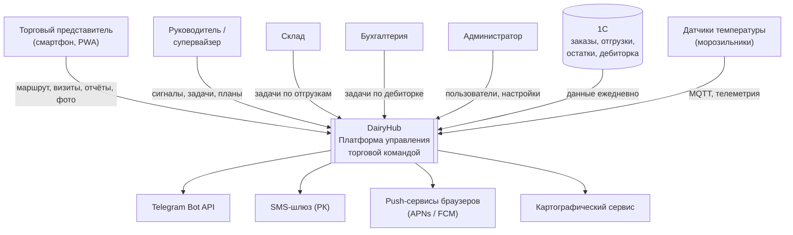
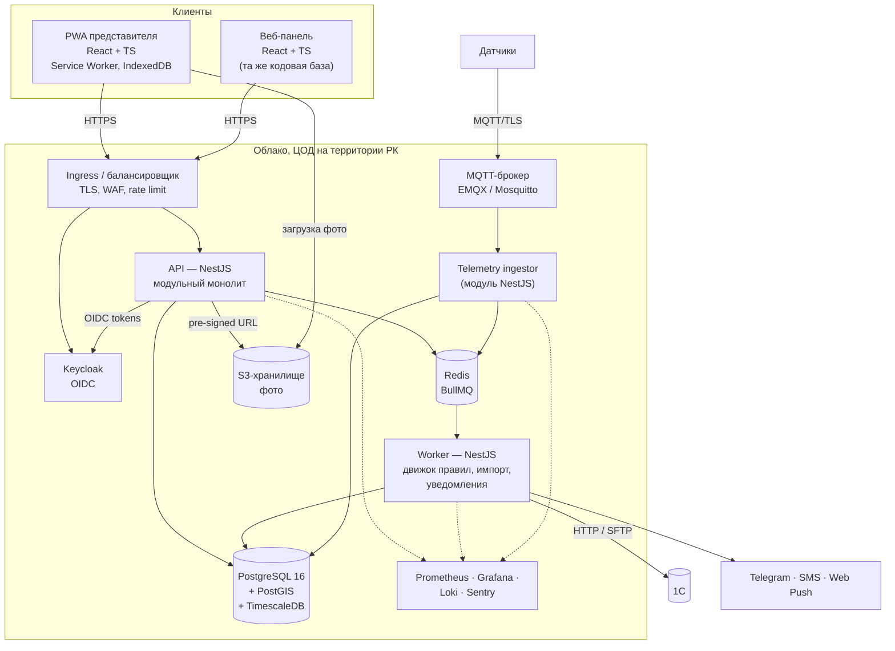
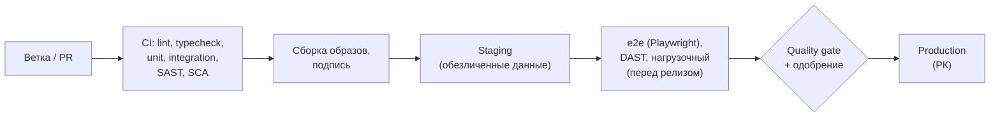
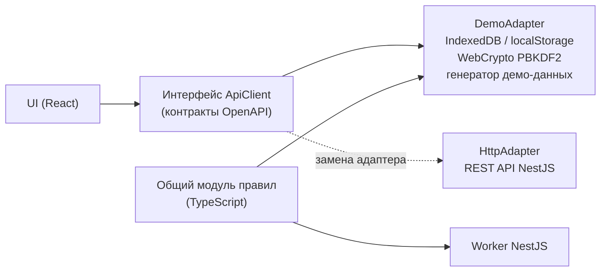

# 04. Архитектура

| Атрибут | Значение |
|---|---|
| Продукт | DairyHub |
| Версия документа | 1.0 |
| Автор | Архитектор проекта |
| Связанные документы | [03 — Системный анализ](03-system-analysis.md), [05 — План проекта](05-project-plan.md) |

Документ описывает **целевую продуктовую архитектуру** (разделы 1–10) и **демо-реализацию** (раздел 11), которая уже работает как публичный прототип и реализует те же контракты.

---

## 1. Архитектурные драйверы

| Драйвер | Источник | Влияние на архитектуру |
|---|---|---|
| Работа представителей в полевых условиях с нестабильной связью | NFR-04, NFR-05 | PWA с офлайн-очередью, идемпотентный API |
| Межотдельная логика правил по расписанию и событиям | FR-030–FR-038 | Выделенный движок правил, очередь задач |
| Телеметрия датчиков | FR-064 | MQTT + временные ряды (TimescaleDB) |
| Хранение ПДн на территории РК | NFR-12 | Облако с размещением в РК; никаких ПДн у зарубежных SaaS |
| Ограниченный бюджет разработки (9 млн ₸) и срок 6 месяцев | CN-01 | Модульный монолит, одна кодовая база фронтенда, managed-сервисы, open-source |
| Безопасность | NFR-08–NFR-11 | OIDC, RBAC + RLS, шифрование, аудит |

## 2. Обзор целевой архитектуры

| Слой | Технология | Назначение |
|---|---|---|
| Клиент | React + TypeScript, PWA (Service Worker, IndexedDB) — **одна кодовая база** для мобильного приложения представителя и веб-панели | UI, офлайн, push |
| API | Node.js, NestJS — **модульный монолит** (модули из [03, раздел 1](03-system-analysis.md#1-модули-системы-и-их-связи)) | REST API, бизнес-логика |
| Фоновые задачи | Тот же код NestJS в режиме worker; Redis + BullMQ | Движок правил, напоминания, уведомления, импорт 1С |
| Данные | PostgreSQL 16 + PostGIS (геозоны), TimescaleDB (телеметрия) | Основное хранилище |
| Кэш / очередь | Redis | Очереди BullMQ, rate limiting, кэш |
| Файлы | S3-совместимое объектное хранилище (в РК) | Фото |
| IoT | MQTT-брокер (EMQX или Mosquitto) | Приём телеметрии датчиков |
| Идентификация | Keycloak (OIDC) | Вход, сессии, политика паролей, блокировки |
| Уведомления | Web Push (VAPID), Telegram-бот, SMS-шлюз | Каналы доставки |
| Интеграция | Адаптер 1С (HTTP-сервис / SFTP) | Продажи, отгрузки, остатки, дебиторка |
| Хостинг | Облако с размещением ЦОД в РК (Kubernetes или VM + Docker Compose — по объёму) | Резидентность данных |
| Наблюдаемость | Prometheus, Grafana, Loki, Sentry, OpenTelemetry | Метрики, логи, ошибки, трассировка |

## 3. C4 — уровень 1: контекст системы

## 4. C4 — уровень 2: контейнеры

### 4.1. Компоненты API (уровень 3, кратко)

| Модуль NestJS | Публикует события | Подписан на |
|---|---|---|
| `iam` | `user.blocked`, `user.locked` | — |
| `routes-visits` | `visit.checked_in`, `visit.checked_out`, `visit.report_completed`, `freezer.missing_reported` | — |
| `sales` | `sales.imported` | `integration.1c.done` |
| `rules-engine` | `signal.created`, `hypothesis.created` | `sales.imported`, `visit.*`, `telemetry.alarm`, cron |
| `signals` | `signal.status_changed` | `hypothesis.created`, `task.closed` |
| `tasks` | `task.created`, `task.sla_breached`, `task.closed` | `hypothesis.created` |
| `plans` | `plan.approved` | `task.closed` (потери), cron |
| `equipment` | `freezer.status_changed`, `telemetry.alarm` | `visit.report_completed` |
| `notifications` | — | все события, требующие уведомления |
| `audit` | — | все команды изменения |

Модули общаются через внутреннюю шину событий (in-process + BullMQ для асинхронных), не обращаются к таблицам друг друга напрямую. Это позволяет при необходимости выделить модуль в отдельный сервис без переписывания.

## 5. Ключевые технические решения (ADR)

| ADR | Решение | Альтернативы | Обоснование |
|---|---|---|---|
| ADR-001 | PWA вместо нативных приложений | React Native, Swift/Kotlin | Одна кодовая база для мобильного и веб; нет затрат на публикацию в сторах; офлайн и push поддерживаются (на iOS — для PWA, добавленных на домашний экран, iOS 16.4+). Риск ограничений iOS принят и проверяется на М2 |
| ADR-002 | Модульный монолит на NestJS | Микросервисы | Команда из нескольких человек и бюджет 9 млн ₸ не окупают операционную сложность микросервисов; границы модулей сохраняют путь к разделению |
| ADR-003 | TypeScript на фронтенде и бэкенде | Java/Kotlin, Go, Python | Общие типы контрактов, один язык для компактной команды |
| ADR-004 | PostgreSQL 16 + PostGIS | MySQL, MongoDB | Транзакционность, геозапросы (геозона, расстояния по маршрутам), RLS для изоляции компаний |
| ADR-005 | TimescaleDB для телеметрии | InfluxDB, ClickHouse | Расширение PostgreSQL — меньше компонентов; continuous aggregates для окон 2 ч |
| ADR-006 | Redis + BullMQ | RabbitMQ, Kafka | Достаточно для объёма; отложенные задачи (напоминание через 30 мин), повторы, cron |
| ADR-007 | Keycloak (OIDC) | Собственная аутентификация, Auth0 | Open-source, размещается в РК (Auth0 — зарубежный SaaS, конфликт с резидентностью); политика паролей и brute-force detection «из коробки» |
| ADR-008 | MQTT для датчиков | HTTP-push от датчиков | Стандарт для IoT, экономия трафика, QoS |
| ADR-009 | S3-совместимое хранилище в РК | Хранение в БД | Масштабируемость; pre-signed URL снимают нагрузку с API |
| ADR-010 | Хостинг в облаке с ЦОД в РК | Зарубежные облака | Требование Закона РК «О персональных данных и их защите» о хранении ПДн на территории РК |
| ADR-011 | Правила как код с параметрами в БД | BPM/правила-движок (Drools и т. п.) | Правил немного, они детерминированы; параметры (пороги) настраиваются без релиза; полное покрытие unit-тестами |
| ADR-012 | Контракт API в OpenAPI 3.1, клиент генерируется | Ручные клиенты | Единые типы; один и тот же контракт реализует демо-адаптер |

## 6. Безопасность

| Область | Меры |
|---|---|
| Стандарт | OWASP ASVS 4.0 уровень 2 как чек-лист; OWASP Top 10 в код-ревью |
| Аутентификация | Keycloak OIDC (Authorization Code + PKCE); политика паролей ≥ 8 символов, буквы и цифры; brute-force detection: 5 попыток → 15 мин; сессия 12 ч / 30 дней («Запомнить меня» — refresh token с ротацией) |
| Хранение паролей | Хэш в Keycloak (PBKDF2-SHA256 с высоким числом итераций или Argon2) |
| Авторизация | RBAC на уровне API (guards NestJS) + Row-Level Security в PostgreSQL по `company_id` |
| Транспорт | TLS 1.2+ (предпочтительно 1.3), HSTS; MQTT только по TLS с клиентскими учётными данными на датчик |
| Данные в покое | Шифрование дисков БД, бэкапов и объектного хранилища; секреты — в менеджере секретов (Vault / Kubernetes Secrets с шифрованием) |
| Веб-защита | CSP, защита от CSRF (SameSite cookies / токены), валидация входных данных (class-validator/zod), лимиты запросов, WAF |
| Файлы | Проверка MIME и размера, удаление EXIF кроме времени/координат, хранение без публичного доступа |
| Аудит | Неизменяемый журнал (append-only таблица, права только на INSERT), экспорт в лог-хранилище |
| ПДн | Хранение в РК; согласия сотрудников; минимизация (GPS только при действиях); сроки хранения; доступ по ролям |
| Зависимости | SCA (npm audit / Dependabot / Trivy), SAST (Semgrep), DAST (OWASP ZAP) в CI |
| Процессы | Пентест перед запуском (М5–М6); план реагирования на инциденты |

## 7. Надёжность, бэкапы, RPO/RTO

| Параметр | Цель | Как достигается |
|---|---|---|
| RPO | ≤ 15 мин | Непрерывная архивация WAL (pgBackRest / WAL-G) + ежедневный полный бэкап |
| RTO | ≤ 4 ч | Документированный runbook восстановления; ежеквартальные учения |
| Хранение бэкапов | 30 дней ежедневных, 12 ежемесячных (уточняется юристом) | Объектное хранилище в РК, шифрование |
| Фото | Версионирование бакета, репликация в пределах РК (если доступна у провайдера) | — |
| Доступность | ≥ 99,5% в рабочее время | Health-checks, автоперезапуск, 2 реплики API |

## 8. Наблюдаемость

- **Метрики** (Prometheus): RPS, латентность p50/p95/p99, ошибки, длина очередей BullMQ, длительность правил, задержка импорта 1С, число активных датчиков.
- **Дашборды** (Grafana): технический, бизнес-операционный (визиты сегодня, сигналы, просроченные задачи).
- **Логи** (Loki): структурированный JSON с `trace_id`, без ПДн в открытом виде.
- **Ошибки** (Sentry, self-hosted в РК — чтобы не передавать ПДн за рубеж): фронтенд и бэкенд.
- **Трассировка**: OpenTelemetry.
- **Алерты**: недоступность API, ошибка импорта 1С, очередь правил не обработана к 07:00, рост 5xx, молчание MQTT.

## 9. CI/CD и окружения

| Окружение | Назначение | Данные |
|---|---|---|
| dev | Локальная разработка (Docker Compose) | Синтетические |
| staging | Интеграционное тестирование, UAT | Обезличенные |
| production | Пилот и эксплуатация | Реальные, в РК |

Миграции БД — версионируемые (Prisma Migrate / TypeORM migrations), обратно совместимые; релизы — rolling update; feature flags для поэтапного включения правил.

## 10. Масштабирование

| Узкое место | Стратегия |
|---|---|
| API | Горизонтальное масштабирование stateless-реплик |
| Движок правил | Разбиение пакетов по `company_id` / территории в BullMQ; параллельные воркеры; инкрементальный расчёт по изменившимся точкам |
| Аналитика | Материализованные представления, агрегаты по дням; при росте — реплика чтения |
| Телеметрия | Гипертаблицы TimescaleDB, сжатие старых чанков, ретенция сырых данных (например, 90 дней) с сохранением агрегатов |
| Фото | Объектное хранилище, CDN в пределах требований резидентности |
| Мультиарендность | `company_id` + RLS; крупному клиенту — отдельная БД |
| Выделение сервисов | При необходимости первыми выделяются `telemetry` и `notifications` (независимая нагрузка) |

## 11. Демо-реализация

Публичная демонстрационная версия DairyHub позволяет оценить продукт до появления серверной части и не требует инфраструктуры.

### 11.1. Состав

| Аспект | Решение |
|---|---|
| Тип | Статическое SPA: React + TypeScript + Vite |
| Хостинг | GitHub Pages |
| Слой данных | Браузерный **API-адаптер** (IndexedDB / localStorage), реализующий **те же контракты**, что и REST API из [03, раздел 8](03-system-analysis.md#8-api-контракты-rest) |
| Пароли | Хэширование PBKDF2 (WebCrypto API) с солью; пароль в открытом виде не хранится |
| Сессии | С истечением срока (12 ч / 30 дней с «Запомнить меня») |
| Защита от перебора | Блокировка после 5 неудачных попыток входа на 15 минут |
| Изоляция | Каждый посетитель получает изолированное демо-пространство с автоматически сгенерированными демо-данными (точки, представители, продажи, отгрузки, морозильники, телеметрия) |
| Движок правил | Тот же код правил, что планируется для сервера (общий TypeScript-модуль), выполняется в браузере |

### 11.2. Схема

### 11.3. Переход на реальный бэкенд

Переход сводится к **замене адаптера**: `DemoAdapter` заменяется на `HttpAdapter`, который вызывает REST API. UI-компоненты, типы и модуль правил не меняются. Дополнительно при переходе:

1. Аутентификация переносится в Keycloak (OIDC); локальное хранение хэшей паролей удаляется.
2. Генератор демо-данных отключается; данные поступают из 1С и PWA.
3. Офлайн-очередь сохраняется, но синхронизируется с `/api/v1/sync`.

### 11.4. Ограничения демо

| Ограничение | Пояснение |
|---|---|
| Данные только в браузере посетителя | Очистка данных сайта удаляет демо-пространство; данные не передаются между устройствами |
| Безопасность демонстрационного уровня | Клиентская аутентификация защищает только локальные демо-данные и не является серверной защитой; **реальные персональные данные в демо вводить нельзя** |
| Нет реальных интеграций | 1С, датчики и GPS-маршруты имитируются генератором (GPS устройства используется для демонстрации check-in) |
| Уведомления | Только внутри приложения |
| Время | Расписание правил (06:00, 18:00, 19:00) может запускаться вручную для демонстрации |
