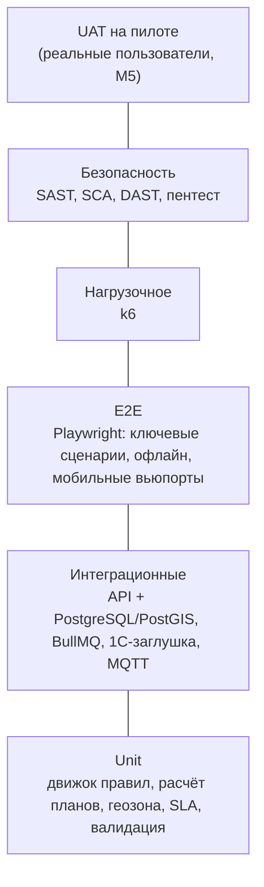
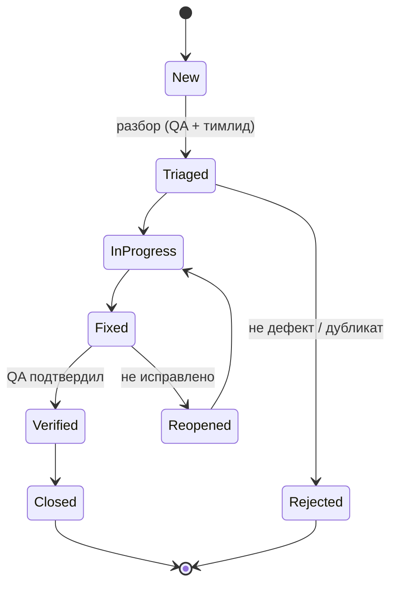

# 06. План тестирования (QA)

| Атрибут | Значение |
|---|---|
| Продукт | DairyHub |
| Версия документа | 1.0 |
| Автор | QA-инженер проекта |
| Связанные документы | [02 — Бизнес-требования](02-business-requirements.md), [03 — Системный анализ](03-system-analysis.md), [05 — План проекта](05-project-plan.md) |

---

## 1. Цели тестирования

1. Подтвердить, что бизнес-правила (пороги, формулы, SLA) реализованы **точно** так, как описано в [03, раздел 5](03-system-analysis.md#5-бизнес-правила).
2. Подтвердить работу ключевых сценариев всех ролей на целевых устройствах, в том числе офлайн.
3. Подтвердить соответствие нефункциональным требованиям (производительность, безопасность, ПДн).
4. Подтвердить на пилоте (UAT), что продукт применим в реальной работе.

## 2. Стратегия: пирамида тестирования

| Уровень | Что проверяется | Инструменты | Ответственный | Когда | Цель покрытия |
|---|---|---|---|---|---|
| Unit | Движок правил (падение продаж, 7 причин, уверенность, маршрутизация), план и скорректированное выполнение, геозона, длительность визита, SLA, политика паролей, блокировка | Vitest / Jest, «часы» с подменой времени | Разработчики | Каждый коммит | Движок правил ≥ 90% строк и 100% правил из [03, разд. 5]; общее ≥ 70% |
| Интеграционные | API ↔ БД (RLS, транзакции), очередь (отложенные напоминания), импорт 1С (на заглушке и тестовой базе 1С), MQTT-ингест, загрузка фото в S3 | Testcontainers, Supertest | Разработчики, QA | Каждый PR | Все эндпоинты из [03, разд. 8] |
| Контрактные | Соответствие API спецификации OpenAPI; совпадение поведения демо-адаптера и HTTP-адаптера | Schemathesis / собственные контрактные тесты | Тимлид, QA | Каждый PR | Все контракты |
| E2E | Сквозные сценарии ролей, офлайн-режим, PWA | Playwright (в т. ч. эмуляция мобильных устройств и геолокации) | QA | Ночная сборка, перед релизом | Все тест-кейсы раздела 4 с приоритетом P1 |
| Нагрузочное | API представителей в пиковое утро, расчёт правил к 07:00, приём телеметрии | k6 | QA, DevOps | М4, перед запуском | NFR-01, NFR-02, NFR-03 |
| Безопасность | OWASP ASVS L2 (выборочно), Top 10, зависимости, RBAC/RLS, перебор паролей | Semgrep, Trivy, OWASP ZAP, внешний пентест | QA, DevOps, подрядчик | CI + М5 | Нет уязвимостей High/Critical |
| UAT | Применимость в реальной работе | Сценарии UAT, анкеты | Ключевые пользователи, QA | М5 | Критерии выхода из пилота |

**Управление временем в тестах.** Все правила, зависящие от времени (19:00, 18:00, 30 мин, 2 ч, 3 дня, 14 дней, 8 недель, 15 мин блокировки, 12 ч / 30 дней сессии), тестируются через инъекцию часов (`Clock`), а не ожиданием реального времени.

## 3. Тестовые данные

| Набор | Состав |
|---|---|
| Компания «Тест» | 1 admin, 2 manager, 6 rep, 1 warehouse, 1 accounting |
| Точки | 30 точек категорий A/B/C с координатами в Алматы и Астане; 10 с морозильниками, из них 4 с датчиками |
| Продажи | Синтетические за 20 недель, включая сценарии: стабильные продажи; падение 25% / 30% / 35%; 0 продаж замороженной продукции 2 и 3 дня |
| Отгрузки | Своевременные, с задержкой, с недогрузом |
| Дебиторка | Без просрочки; с просрочкой и блокировкой |
| Телеметрия | Норма −20 °C; −16 °C; −14 °C в течение 1 ч 59 мин; −14 °C в течение 2 ч 01 мин |

Персональные данные в тестах — только синтетические; на staging — обезличенные.

## 4. Тест-кейсы ключевых сценариев

Приоритет: **P1** — блокирующий для релиза, **P2** — важный, **P3** — желательный.

### 4.1. Аутентификация, регистрация, блокировка

| ID | Сценарий | Предусловия | Шаги / данные | Ожидаемый результат | Пр. | Требование |
|---|---|---|---|---|---|---|
| TC-AUTH-01 | Регистрация компании | Пользователь не зарегистрирован | Название компании, имя, e-mail, пароль `Milk2026` | Компания создана; пользователь — `admin`; вход выполнен | P1 | FR-001 |
| TC-AUTH-02 | Слабый пароль: короткий | — | Пароль `Milk26` (7 символов) | Отказ `WEAK_PASSWORD`, пояснение | P1 | FR-003 |
| TC-AUTH-03 | Слабый пароль: без цифр | — | `MilkMilk` | Отказ `WEAK_PASSWORD` | P1 | FR-003 |
| TC-AUTH-04 | Слабый пароль: без букв | — | `12345678` | Отказ `WEAK_PASSWORD` | P1 | FR-003 |
| TC-AUTH-05 | Граница: ровно 8 символов | — | `Milk2026` | Принят | P1 | FR-003 |
| TC-AUTH-06 | Регистрация по приглашению с ролью | Admin создал код с ролью `warehouse` | Регистрация с кодом | Пользователь в компании, роль `warehouse`; выбрать другую роль нельзя | P1 | FR-002 |
| TC-AUTH-07 | Отозванный / использованный / истёкший код | Код отозван | Регистрация с кодом | Отказ `INVITE_INVALID` | P1 | FR-002 |
| TC-AUTH-08 | Блокировка после 5 попыток | Пользователь активен | 5 раз неверный пароль | После 5-й попытки `ACCOUNT_LOCKED`, `locked_until` = +15 мин | P1 | FR-004 |
| TC-AUTH-09 | Верный пароль во время блокировки | TC-AUTH-08 | Через 10 мин верный пароль | Отказ `ACCOUNT_LOCKED` | P1 | FR-004 |
| TC-AUTH-10 | Окончание блокировки | TC-AUTH-08 | Через 15 мин 1 с — верный пароль | Вход выполнен; счётчик сброшен | P1 | FR-004 |
| TC-AUTH-11 | Сброс счётчика при успехе | — | 4 неверных, 1 верный, 4 неверных | Блокировки нет | P2 | FR-004 |
| TC-AUTH-12 | Сессия 12 ч | Вход без «Запомнить меня» | Время +11 ч 59 мин; затем +12 ч 01 мин | Сначала доступ есть; затем `SESSION_EXPIRED` | P1 | FR-005 |
| TC-AUTH-13 | Сессия 30 дней | Вход с «Запомнить меня» | +29 дней; +30 дней 1 мин | Доступ есть; затем истекла | P1 | FR-005 |
| TC-AUTH-14 | Блокировка администратором | Пользователь с активной сессией | Admin блокирует | Текущая сессия аннулирована; вход — `USER_BLOCKED` | P1 | FR-006 |
| TC-AUTH-15 | Сброс пароля | — | Admin сбрасывает пароль | Временный пароль; при входе обязательная смена | P2 | FR-006 |
| TC-AUTH-16 | Сообщение не раскрывает существование логина | — | Неверный e-mail / неверный пароль | Одинаковое сообщение `INVALID_CREDENTIALS` | P1 | NFR-08 |
| TC-AUTH-17 | Изоляция компаний | Две компании | Пользователь А запрашивает точку компании Б по id | `403`/`404`, данные не раскрыты | P1 | FR-007 |

### 4.2. GPS check-in и визиты

| ID | Сценарий | Предусловия | Шаги / данные | Ожидаемый результат | Пр. | Требование |
|---|---|---|---|---|---|---|
| TC-VIS-01 | Check-in внутри геозоны | Плановый визит | Координаты в 80 м, точность 20 м | `in_progress`, флагов нет | P1 | FR-011 |
| TC-VIS-02 | Граница геозоны | — | 150 м | Внутри геозоны (условие «> 150 м» не выполнено) | P1 | FR-012 |
| TC-VIS-03 | Вне геозоны без комментария | — | 151 м, комментарий пуст | `422 OUTSIDE_GEOFENCE_COMMENT_REQUIRED` | P1 | FR-012 |
| TC-VIS-04 | Вне геозоны с комментарием | — | 400 м, комментарий «Магазин переехал через дорогу» | Визит начат, флаг `outside_geofence`, комментарий сохранён | P1 | FR-012 |
| TC-VIS-05 | Низкая точность GPS | — | Точность 101 м | Предупреждение `LOW_GPS_ACCURACY`, флаг `low_accuracy`; визит начат | P1 | FR-013 |
| TC-VIS-06 | Граница точности | — | Точность 100 м | Без предупреждения | P2 | FR-013 |
| TC-VIS-07 | Короткий визит | Check-in 10:00:00 | Check-out 10:04:59 | Флаг `short_visit` | P1 | FR-014 |
| TC-VIS-08 | Граница короткого визита | Check-in 10:00:00 | Check-out 10:05:00 | Без флага | P1 | FR-014 |
| TC-VIS-09 | Нет разрешения на геолокацию | Разрешение отклонено | Check-in | Объяснение; возможен визит с флагом и комментарием | P2 | 03, разд. 10.2 |
| TC-VIS-10 | Напоминание об отчёте | Check-out 14:00, отчёт черновик | Время 14:30 | Напоминание представителю | P1 | FR-017 |
| TC-VIS-11 | Нет напоминания при завершённом отчёте | Отчёт завершён в 14:20 | Время 14:30 | Напоминания нет | P1 | FR-017 |
| TC-VIS-12 | Итоговое напоминание 18:00 | 2 незавершённых отчёта | Время 18:00 | Одно сводное напоминание со списком из 2 визитов | P2 | FR-017 |
| TC-VIS-13 | Офлайн-визит | Режим «без сети» | Check-in, отчёт, 2 фото; включить сеть | Все данные синхронизированы; `client_ts` сохранён; дубликатов нет | P1 | FR-018, NFR-04 |
| TC-VIS-14 | Идемпотентность | — | Повторная отправка check-in с тем же `Idempotency-Key` | Один визит; тот же ответ | P1 | 03, разд. 10 |
| TC-VIS-15 | Закрытие приложения офлайн | Офлайн-отчёт в очереди | Закрыть/открыть PWA | Очередь сохранена | P1 | NFR-04 |

### 4.3. Пропущенный визит

| ID | Сценарий | Предусловия | Шаги / данные | Ожидаемый результат | Пр. | Требование |
|---|---|---|---|---|---|---|
| TC-MIS-01 | Пропущенный визит | Плановый визит, нет check-in; у представителя нет других пропусков за 7 дней | Время 19:00 | Статус `Missed`, виден представителю; сигнала руководителю нет | P1 | FR-015 |
| TC-MIS-01a | Порог агрегата | 2 пропуска за последние 7 дней | Третий пропуск в 19:00 | Один сигнал `missed_visit` по представителю; уведомление и задача руководителю (48 ч) | P1 | FR-015, BRL-VIS-05a |
| TC-MIS-01b | Скользящее окно | Пропуски 8 и 3 дня назад | Новый пропуск сегодня | В окне 7 дней 2 пропуска — сигнала нет | P1 | BRL-VIS-05a |
| TC-MIS-01c | Дополнение сигнала | Открыт сигнал (3 пропуска) | Четвёртый пропуск в окне | Новый сигнал не создан; существующий обновлён | P2 | BRL-VIS-05a |
| TC-MIS-02 | До конца дня | — | Время 18:59 | Статус `Planned` | P1 | FR-015 |
| TC-MIS-03 | Визит начат, не завершён | Check-in 18:30 | Время 19:00 | Не `Missed`; руководитель видит «незакрытый визит» | P2 | 03, разд. 4.1 |
| TC-MIS-04 | Офлайн-check-in пришёл после 19:00 | Ровно 3 пропуска, сигнал открыт; один из них — check-in офлайн с `client_ts` 17:40 | Синхронизация в 19:20 | `Missed` пересмотрен; агрегат = 2, сигнал закрыт с пометкой | P1 | 03, разд. 10.1 |
| TC-MIS-05 | Часовой пояс компании | Компания в Asia/Almaty | Сервер в UTC | Правило срабатывает в 19:00 по времени компании | P1 | — |

### 4.4. Падение продаж ≥ 30%

| ID | Сценарий | Данные | Ожидаемый результат | Пр. | Требование |
|---|---|---|---|---|---|
| TC-DRP-01 | Падение 35% | Предыдущие 4 недели: 100/нед (среднее 100), последние 7 дней: 65 | Сигнал `sales_drop`, `drop_pct = 35` | P1 | FR-031 |
| TC-DRP-02 | Граница 30% | Среднее 100, текущее 70 | Сигнал создан | P1 | FR-031 |
| TC-DRP-03 | Ниже порога | Среднее 100, текущее 71 (29%) | Сигнала нет | P1 | FR-031 |
| TC-DRP-04 | Разные недели в базе | 4 недели: 120, 80, 100, 100 (среднее 100); текущее 69 | Сигнал, 31% | P1 | BRL-SAL-01 |
| TC-DRP-05 | Окна не пересекаются | Продажи дня D-7 | Входят в базу, не в текущее окно | P1 | BRL-SAL-01 |
| TC-DRP-06 | Малая база SKU | Точка × SKU: база 13 ед./нед., текущее 5 | Сигнала уровня SKU нет | P1 | BRL-SAL-04 |
| TC-DRP-06a | Граница базы SKU | База 14 ед./нед., текущее 9 (−35,7%) | Сигнал уровня SKU создан | P1 | BRL-SAL-04 |
| TC-DRP-06b | Падение по представителю | Выручка представителя по незамороженной продукции: среднее 4 недель 2 000 000 ₸, последние 7 дней 1 400 000 ₸ (−30%) | Один сигнал `scope = rep` | P1 | FR-031a |
| TC-DRP-06c | Свёртка сигналов точек | TC-DRP-06b + 3 точки этого представителя с падением ≥ 30% | Сигналы точек вложены в сигнал представителя, задачи не дублируются | P1 | BRL-SAL-04a |
| TC-DRP-06d | Мороженое не учитывается | Выручка представителя упала только за счёт `is_frozen` SKU | Сигнала уровня представителя нет | P2 | BRL-SAL-04a |
| TC-DRP-07 | Дедупликация | Открыт сигнал по той же точке/SKU; повторный расчёт | Новый сигнал не создан; метрики обновлены | P1 | FR-037 |
| TC-DRP-08 | Причина: недогруз | 2 из 3 отгрузок с `qty_shipped < qty_ordered` | Гипотеза `delivery`, high; задача складу, срок +24 ч | P1 | FR-032–034 |
| TC-DRP-09 | Причина: дебиторка | `shipment_blocked = true` | Гипотеза `debt_block`; задача бухгалтерии, +48 ч | P1 | FR-032–034 |
| TC-DRP-10 | Причина: визиты (high) | За 14 дней 2 из 4 плановых визитов пропущены (50%) | Гипотеза `visits`, high; задача руководителю, +48 ч | P1 | FR-034 |
| TC-DRP-10a | Причина: визиты (medium) | За 14 дней 3 из 10 пропущены (30%) | Гипотеза `visits`, medium (доля < 40%) | P1 | BRL C1 |
| TC-DRP-10b | Причина: короткие визиты | 0 пропусков, 2 коротких визита за 14 дней | Гипотеза `visits`, medium | P1 | BRL C1 |
| TC-DRP-10c | Ниже порога | 1 пропуск из 5 (20%), 1 короткий визит | Гипотезы `visits` нет | P1 | BRL C1 |
| TC-DRP-10d | Минимум плановых | 2 пропуска из 2 плановых | Гипотеза `visits`, high | P2 | BRL C1 |
| TC-DRP-10e | Меньше 2 плановых | 1 пропуск из 1 планового за 14 дней (доля 100%) | Гипотезы `visits` нет (нужно ≥ 2 плановых) | P1 | BRL C1 |
| TC-DRP-11 | Причина: out-of-stock | В 2 отчётах out-of-stock по SKU | Гипотеза `out_of_stock`, high; задача представителю до следующего визита | P1 | FR-034 |
| TC-DRP-12 | Причина: цена | Наша цена 560 ₸, конкурент 500 ₸ (индекс 112%) | Гипотеза `price_index`, medium; задача руководителю | P1 | FR-032 |
| TC-DRP-13 | Граница индекса цены | Индекс ровно 110% | Гипотезы нет (условие «> 110%») | P1 | FR-032 |
| TC-DRP-14 | Причина: конкурент | В отчёте отмечена акция конкурента | Гипотеза `competitor_activity`; задача руководителю | P2 | FR-032 |
| TC-DRP-15 | Причина: морозильник | Отметка «отсутствует» в окне | Гипотеза `freezer`, high | P2 | FR-032 |
| TC-DRP-16 | Несколько причин | Недогруз + акция конкурента | 2 гипотезы, 2 задачи разным подразделениям | P1 | FR-033 |
| TC-DRP-17 | Причин нет | Нет данных о причинах | Статус `NoCause`; задача руководителю «ручной анализ» | P2 | 03, разд. 4.3 |
| TC-DRP-18 | Отклонение гипотезы | Склад отклоняет без комментария / с комментарием | Без комментария — ошибка; с комментарием — `rejected`, руководитель уведомлён | P1 | FR-035 |
| TC-DRP-19 | Контроль результата 14 дней | Все задачи закрыты в день D | D+13: `Control`; D+14: `Resolved` или `Reopened` по критерию восстановления | P1 | FR-036 |

### 4.5. Три дня без продаж (морозильник)

| ID | Сценарий | Данные | Ожидаемый результат | Пр. | Требование |
|---|---|---|---|---|---|
| TC-FNS-01 | 3 дня без продаж | Точка с активным морозильником; продажи `is_frozen` = 0 три дня подряд | Уведомление представителю; программа, этап 1 | P1 | FR-070 |
| TC-FNS-02 | 2 дня без продаж | 0, 0, затем продажа | Уведомления нет | P1 | FR-070 |
| TC-FNS-03 | Прерванная серия | 0, продажа, 0, 0 | Уведомления нет | P1 | FR-070 |
| TC-FNS-04 | Продажи незамороженной продукции | Молоко продаётся, мороженое — 0 три дня | Уведомление (учитываются только `is_frozen`) | P2 | BRL-FNS-01 |
| TC-FNS-05 | Диагностика: чек-лист 6 причин | Этап 1; отмечены «неправильная выкладка», «неконкурентная цена» | Этап 2 с 2 действиями и ответственными | P1 | FR-071–072 |
| TC-FNS-06 | Оценка перемещения | День 56 программы; выручка мороженого за 30 дней 100 000 ₸ (< 120 000); кандидаты: К1 — молочная выручка 1 000 000 ₸, A, 3 км; К2 — 600 000 ₸, B, 9 км; К3 — 800 000 ₸, C, 18 км | Потенциалы 190 000 / 114 000 / 152 000 ₸. Score: К1 = 0,55·1 + 0,30·1 + 0,15·0,8 = 0,97; К2 = 0,55·0,6 + 0,30·0,7 + 0,15·0,4 = 0,60; К3 = 0,55·0,8 + 0,30·0,3 + 0 = 0,53. Порядок К1, К2, К3; автоматического перемещения нет | P1 | FR-073–074 |
| TC-FNS-06a | Слишком рано | День 55, выручка мороженого 100 000 ₸ | Оценка не рассчитывается | P1 | BRL-FNS-06 |
| TC-FNS-06b | Точка рентабельна | День 60, выручка мороженого 120 000 ₸ | Оценка не рассчитывается (условие «< 120 000») | P1 | BRL-FNS-06 |
| TC-FNS-07 | Решение руководства | После TC-FNS-06 руководитель фиксирует решение с комментарием | Решение и основание сохранены, запись в аудите | P2 | FR-074 |

### 4.6. Морозильник отсутствует

| ID | Сценарий | Шаги / данные | Ожидаемый результат | Пр. | Требование |
|---|---|---|---|---|---|
| TC-FRZ-01 | Фото обязательно | Визит в точку с морозильником, отчёт без фото морозильника | Завершить отчёт нельзя | P1 | FR-061 |
| TC-FRZ-02 | Отметка «Оборудование отсутствует» | Отметить в отчёте | Сигнал `freezer_missing` руководителю + задача, SLA 48 ч; статус морозильника не меняется автоматически | P1 | FR-062 |
| TC-FRZ-03 | Несовпадение серийного номера | Представитель вводит другой номер | Предупреждение; событие для руководителя | P2 | BRL-FRZ-01 |
| TC-FRZ-04 | Жизненный цикл | Active → Repair → Active; Repair → Replacement → WrittenOff | Переходы разрешены, история пишется | P1 | FR-063 |
| TC-FRZ-05 | Недопустимый переход | WrittenOff → Active | `409 INVALID_STATE_TRANSITION` | P1 | FR-063 |
| TC-FRZ-06 | Списание только admin | manager пытается списать | `403` | P2 | RBAC |

### 4.7. Температура вне диапазона

| ID | Сценарий | Телеметрия | Ожидаемый результат | Пр. | Требование |
|---|---|---|---|---|---|
| TC-TMP-01 | Норма | −20 °C | Без сигнала и предупреждений | P1 | FR-064 |
| TC-TMP-02 | Предупреждение | −16 °C 5 ч | Предупреждение на графике, без сигнала | P2 | BRL-FRZ-06 |
| TC-TMP-03 | Короче 2 ч | −14 °C 1 ч 59 мин, затем −19 °C | Без сигнала | P1 | FR-064 |
| TC-TMP-04 | Дольше 2 ч | −14 °C 2 ч 01 мин | Сигнал `freezer_temperature`; задача руководителю (вызов сервиса, 48 ч) и параллельная задача представителю «проверить крышку и питание» (до следующего визита) | P1 | FR-064 |
| TC-TMP-05 | Граница −15 °C | −15,0 °C 3 ч | Без сигнала (условие «> −15 °C») | P1 | FR-064 |
| TC-TMP-06 | Дубликаты сообщений MQTT | Одно сообщение дважды | Одна запись | P2 | 03, разд. 9 |
| TC-TMP-07 | Сообщения не по порядку | Пакет с опоздавшими сообщениями | Окно 2 ч считается по `ts` датчика | P2 | — |
| TC-TMP-08 | Молчание датчика | Нет данных 6 ч | Технический сигнал администратору | P3 | BRL-FRZ-07 |

### 4.8. План и уровни премирования

| ID | Сценарий | Данные | Ожидаемый результат | Пр. | Требование |
|---|---|---|---|---|---|
| TC-PLN-01 | Расчёт плана A | Среднее 3 мес 1 000 000 ₸; сезонность 1,05; A | 1 155 000 ₸ | P1 | FR-050 |
| TC-PLN-02 | Расчёт плана B / C | То же, B; C | 1 050 000 ₸; 997 500 ₸ | P1 | FR-050 |
| TC-PLN-03 | Ограничение не применяется | Высокий коэффициент сезонности 1,40, категория A | План = база × 1,40 × 1,10 без ограничения (cap — только в продуктовой версии) | P2 | BRL-PLN-03 |
| TC-PLN-04 | Ручная корректировка без комментария | — | Отказ | P2 | FR-051 |
| TC-PLN-05 | Скорректированное выполнение | План 1 000 000; факт 760 000; извинительные потери 90 000 | Факт 76%; скорректированное ≈ 83,5%; уровень 80% | P1 | FR-052 |
| TC-PLN-05a | Расчёт извинительных потерь | Первая проблемная поставка 10-го; базовая (T−35…T−8) 50 000 ₸/день; факт 10–14-го: 30 000, 35 000, 60 000, 40 000, 50 000 | Потери = 45 000 ₸ (дни выше базы дают 0) | P1 | BRL-PLN-08 |
| TC-PLN-05b | Нет проблемных поставок | Поставки в месяце без задержек, недогрузов и блокировок | Потери = 0; скорректированное = фактическое | P1 | BRL-PLN-08 |
| TC-PLN-05c | Проблема в прошлом месяце | Последняя проблемная поставка — в предыдущем месяце | В текущем месяце потери = 0 | P2 | BRL-PLN-08 |
| TC-PLN-06 | Граница 80% | Скорректированное 79,99% / 80,00% | Ниже уровня / уровень 80% | P1 | FR-053 |
| TC-PLN-07 | Граница 100% | 99,99% / 100,00% | Уровень 80% / уровень 100% | P1 | FR-053 |
| TC-PLN-08 | Граница 120% | 119,99% / 120,00% | Уровень 100% / уровень 120% | P1 | FR-053 |
| TC-PLN-09 | Суммы премий не заданы | `amount_kzt = null` | Показывается только уровень, без сумм | P1 | BRL-PLN-09 |
| TC-PLN-10 | Остаток до следующего уровня | Скорректированное 93% | Показан остаток до 100% в ₸ | P2 | FR-054 |

### 4.9. Маршрутизация задач и SLA

| ID | Сценарий | Данные | Ожидаемый результат | Пр. | Требование |
|---|---|---|---|---|---|
| TC-TSK-01 | SLA склада | Задача создана 10:00 | `due_at` = +24 ч | P1 | FR-041 |
| TC-TSK-02 | SLA бухгалтерии / руководителя | 10:00 | +48 ч | P1 | FR-041 |
| TC-TSK-03 | SLA представителя | Следующий плановый визит в точку через 3 дня | `due_at` = дата следующего визита | P1 | FR-041 |
| TC-TSK-04 | Напоминание на 75% SLA | Задача склада, прошло 18 ч | Напоминание исполнителю | P2 | 03, разд. 5.9 |
| TC-TSK-05 | Просрочка | Задача не закрыта к `due_at` | `sla_breached = true`; уведомление исполнителю и руководителю | P1 | FR-042 |
| TC-TSK-06 | Права подразделения | Пользователь `warehouse` открывает задачу бухгалтерии | `403` | P1 | RBAC |
| TC-TSK-07 | Переход в контроль | Последняя задача сигнала закрыта | Сигнал → `Control`, `control_until` = +14 дней | P1 | FR-036 |
| TC-TSK-08 | Возврат задачи | Руководитель возвращает `Done` → `InProgress` | Статус изменён, SLA не сбрасывается | P2 | 03, разд. 4.2 |

### 4.10. Администрирование

| ID | Сценарий | Шаги / данные | Ожидаемый результат | Пр. | Требование |
|---|---|---|---|---|---|
| TC-ADM-01 | Срок приглашения | Создать приглашение; попытка регистрации через 7 дней + 1 мин | `INVITE_INVALID` | P1 | FR-091 |
| TC-ADM-02 | Смена роли | `rep` → `manager` | Права меняются при следующем запросе; запись в аудите | P1 | FR-092 |
| TC-ADM-03 | Последний администратор | Единственный admin меняет себе роль | Отказ | P1 | BRL-ADM-03 |
| TC-ADM-04 | «Войти как» | Admin входит как `rep`, открывает маршрут, выходит | Баннер режима; начало, действия и окончание в аудите с указанием admin | P1 | FR-095 |
| TC-ADM-05 | «Войти как» недоступно другим ролям | `manager` вызывает `/users/{id}/impersonate` | `403` | P1 | RBAC |
| TC-ADM-06 | Изменение порога | Admin меняет геозону 150 → 200 м | Новое значение применяется; аудит со старым и новым значением | P2 | FR-097 |

### 4.11. Нефункциональные проверки

| ID | Проверка | Критерий | Требование |
|---|---|---|---|
| TC-NFR-01 | p95 API операций представителя | ≤ 500 мс при штатной нагрузке | NFR-01 |
| TC-NFR-02 | Расчёт правил на полной базе ×1 и ×5 | Завершение до 07:00 | NFR-02, NFR-03 |
| TC-NFR-03 | Размещение данных | БД, бэкапы, фото, логи с ПДн — в ЦОД РК | NFR-12 |
| TC-NFR-04 | Пароли | В БД только хэши; нет паролей в логах | NFR-10 |
| TC-NFR-05 | Аудит | Пользователь не может изменить/удалить записи аудита | NFR-11 |
| TC-NFR-06 | Доступность UI | Зоны нажатия ≥ 44×44 pt; контраст WCAG AA | NFR-14 |
| TC-NFR-07 | Восстановление из бэкапа | RTO ≤ 4 ч, потеря данных ≤ 15 мин | NFR-07 |

## 5. Критерии входа и выхода

### 5.1. Системное тестирование (М4)

| Вход | Выход |
|---|---|
| Функциональность MVP завершена (feature freeze) | 100% тест-кейсов P1 выполнены, ≥ 95% пройдено |
| Unit-покрытие движка правил ≥ 90% | Нет открытых дефектов Critical / High |
| Staging развёрнут, тестовые данные загружены | Открытые Medium — с планом исправления и согласием владельца продукта |
| Интеграция с тестовой базой 1С доступна | Нагрузочный тест пройден (TC-NFR-01, -02) |

### 5.2. Пилот / UAT (М5)

| Вход | Выход |
|---|---|
| Quality gate G4 пройден | Сценарии UAT всех ролей подписаны ключевыми пользователями |
| Пользователи пилота обучены, согласия на обработку ПДн собраны | Нет дефектов Critical/High; ≤ 5 Medium с планом |
| Координаты точек пилота проверены | Сверка 1С без расхождений в течение пилота (или расхождения объяснены) |
| Мониторинг и поддержка пилота развёрнуты | Отчёт по KPI пилота и гипотезам Г1–Г8 подготовлен |
| — | Пентест: нет открытых уязвимостей High/Critical |

### 5.3. Запуск (М6)

Выход из пилота выполнен; runbook и бэкапы проверены (TC-NFR-07); обучение проведено; приёмочный акт подписан.

## 6. Управление дефектами

### 6.1. Классификация

| Серьёзность | Определение | Пример | Срок реакции / исправления |
|---|---|---|---|
| **Critical** | Потеря/порча данных, утечка, недоступность ключевой функции для всех | Офлайн-визиты теряются при синхронизации; доступ к данным другой компании | Реакция 2 ч / исправление 24 ч (hotfix) |
| **High** | Ключевая функция работает неверно, обходного пути нет | Неверный расчёт падения продаж; задача не маршрутизируется | 1 рабочий день / 3 рабочих дня |
| **Medium** | Функция работает с ошибкой, есть обходной путь | Неверная сортировка задач | 3 дня / в следующем спринте |
| **Low** | Косметика, тексты | Опечатка | По возможности |

### 6.2. Жизненный цикл дефекта

Правила: каждый дефект содержит шаги воспроизведения, ожидаемый/фактический результат, окружение, устройство, скриншот/видео; дефект Critical/High сопровождается регрессионным автотестом; триаж — ежедневно на М4–М5.

### 6.3. Метрики качества

Количество открытых дефектов по серьёзности; скорость закрытия; доля переоткрытых; дефекты, найденные на пилоте vs до пилота; стабильность автотестов (flaky rate).

## 7. Матрица устройств

| Платформа | Браузер | Версии | Устройства (минимум) | Режим | Приоритет |
|---|---|---|---|---|---|
| iOS | Safari | 2 последние мажорные версии iOS | iPhone с маленьким экраном (SE-класс), iPhone стандартный | Safari и PWA с домашнего экрана (push, офлайн) | P1 |
| Android | Chrome | 2 последние мажорные версии | Бюджетное устройство (2–3 ГБ ОЗУ), устройство среднего класса | Браузер и установленное PWA | P1 |
| Android | Samsung Internet | Последняя | 1 устройство Samsung | Браузер | P3 |
| Windows | Chrome, Edge | Последние 2 | Ноутбук 1366×768, монитор 1920×1080 | Веб-панель | P1 |
| Windows | Firefox | Последняя | — | Веб-панель | P2 |
| macOS | Safari, Chrome | Последние 2 | MacBook | Веб-панель | P2 |

Дополнительно для мобильных: медленная сеть (3G-профиль), полное отсутствие сети, переключение сеть/офлайн во время синхронизации, отказ в разрешении геолокации, низкий заряд / режим энергосбережения, тёмная тема, крупный системный шрифт.

> Финальный перечень моделей формируется на М1 по фактическому парку смартфонов представителей пилотной группы.
